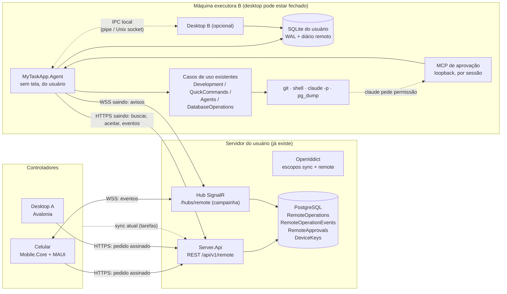
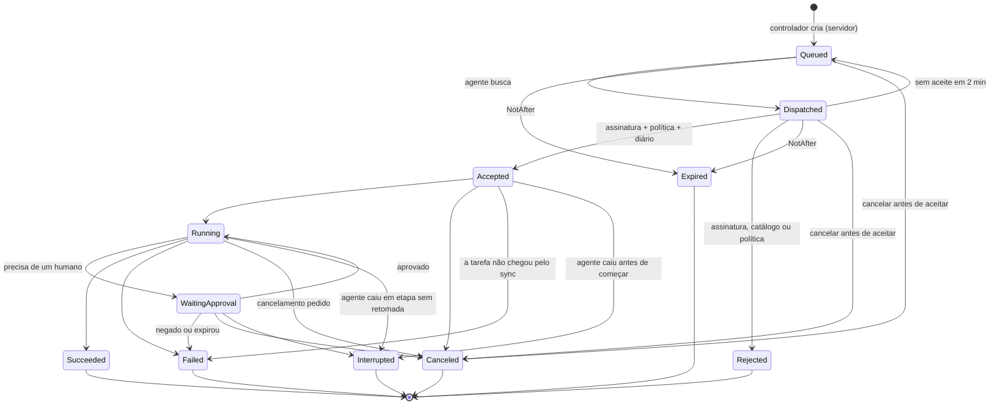
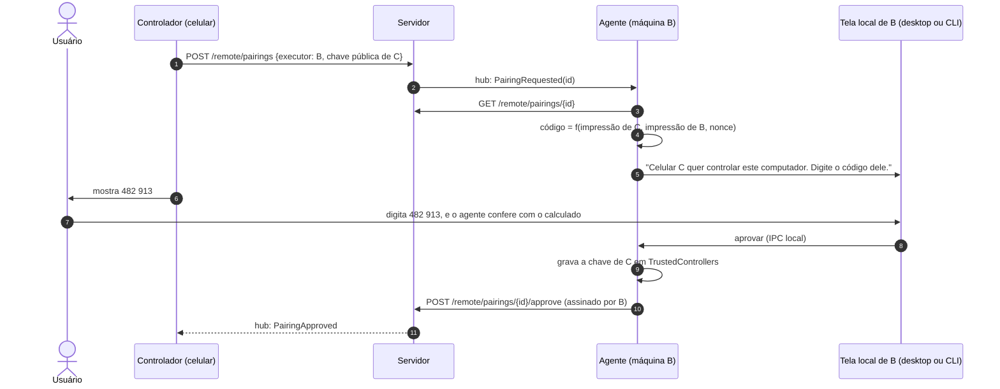
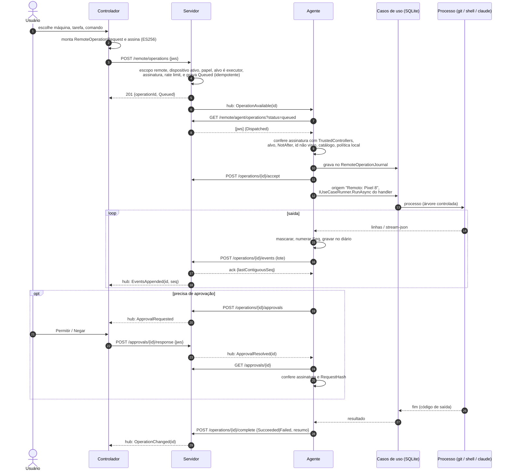
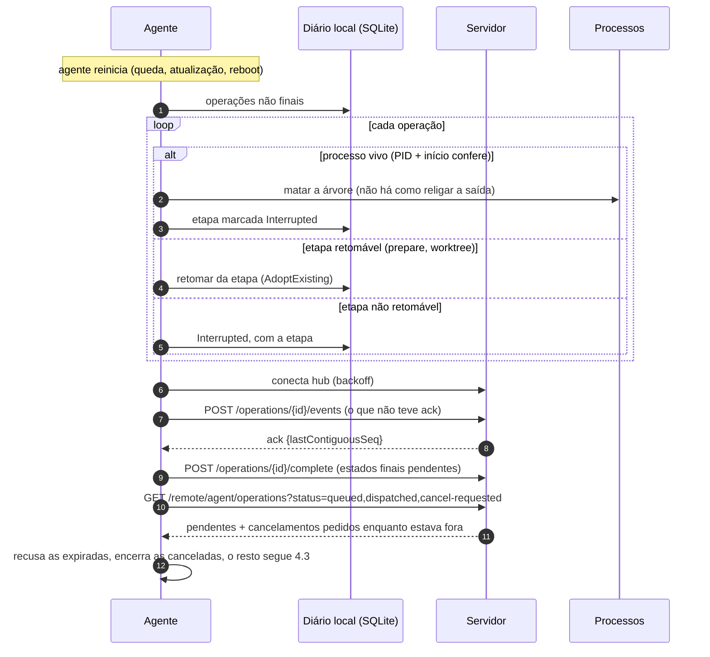

# Orquestração remota — arquitetura (fase 2)

> **Estado: proposta, em implementação** (o roteiro marca as tarefas feitas e o
> commit de cada uma). Este documento é o
> desenho técnico da fase 2; as decisões estão nos ADR-084 a ADR-090 de
> [`ARCHITECTURE.md`](../ARCHITECTURE.md), a análise de ameaças em
> [`remote-security-threat-model.md`](remote-security-threat-model.md) e as
> entregas em [`../roadmap/phase-2-remote-orchestration.md`](../roadmap/phase-2-remote-orchestration.md).

O objetivo da fase 2: de um computador ou do celular, escolher uma máquina,
criar ou escolher uma tarefa, preparar o ambiente de desenvolvimento, rodar os
comandos configurados, mandar um prompt ao Claude Code e acompanhar tudo de
longe — **sem que o desktop precise estar aberto na máquina que executa**.

Sumário:

1. [Inventário do que existe](#1-inventário-do-que-existe)
2. [Arquitetura proposta](#2-arquitetura-proposta)
3. [Contratos e ciclo de vida das operações](#3-contratos-e-ciclo-de-vida-das-operações)
4. [Comunicação e resiliência](#4-comunicação-e-resiliência)
5. [Segurança (resumo)](#5-segurança-resumo)
6. [Reaproveitamento das funcionalidades](#6-reaproveitamento-das-funcionalidades)
7. [Limitações desta análise](#7-limitações-desta-análise)

---

## 1. Inventário do que existe

Levantado no código em 22/10/2026 (master `793e69e`, release 1.24.0), e não só
na documentação. Legenda: **✔** implementado, **◐** parcial, **✘** ausente.

### 1.1 Soluções e camadas

| Solução | Projetos | Observação |
|---|---|---|
| `MyTaskApp.slnx` | `Domain`, `Application`, `Infrastructure`, `Mcp`, `Desktop` + testes | o desktop (Avalonia) |
| `MyTaskApp.Server.slnx` | `Server.Api`, `Server.Application`, `Server.Infrastructure`, `Sync.Contracts` (+ desktop e `Mobile.Core` só para os testes ponta a ponta) | o servidor de sincronização |
| `MyTaskApp.Mobile.slnx` | `Mobile` (MAUI), `Mobile.Core` | o celular (ADR-067) |

- **Domínio sem dependências** e **Application que só define portas**:
  `LayerDependencyTests` (`tests/MyTaskApp.Desktop.Tests/Architecture`) e
  `MobileLayerTests` transformam isso em build quebrada. ✔
- **Casos de uso sem mediador** (ADR-009): handlers concretos `AddScoped` em
  `Application/DependencyInjection.cs`, chamados por `IUseCaseRunner`
  (ADR-012), que abre um escopo por operação. A implementação
  (`ScopedUseCaseRunner`) morava em `Desktop/Composition` e em
  `Mobile.Core/Composition`, e em três harnesses de teste — cinco cópias, fora
  de um lugar que um terceiro host enxergue. ✔ desde a T-09: uma só, em
  `Application/Abstractions`, registrada pelo `AddApplication`.
- **Erro legível**: `DomainException` e filhas (`DevelopmentStepException`,
  `CommandStartException`, `CommandReviewRequiredException`,
  `DatabaseSecurityException`). ✔
- **Origem da operação**: `OperationOrigin.Enter("MCP")` (`AsyncLocal`) faz o
  `ICurrentUser` virar "fulano (MCP)". É o encaixe natural para "(Remoto:
  Pixel 8)". ✔

### 1.2 Persistência local

- `MyTaskAppDbContext` (SQLite, EF Core 10), 40 migrations em
  `Infrastructure/Persistence/Migrations`, aplicadas por
  `DatabaseInitializer.InitializeAsync` no `Program.PrepareDatabase`, antes do
  Avalonia. ✔
- `DatabaseOptions.BuildConnectionString()` é só `Data Source=…`. O ADR-059 e o
  `McpGateway` diziam que "o SQLite não tem WAL"; a T-07 mostrou o contrário: o
  EF Core cria o banco em WAL, e o `mytaskapp.db-wal` existe na pasta de quem
  usa o app. Quanto a escritores concorrentes, o Microsoft.Data.Sqlite já repete
  o comando ocupado até o timeout (30 s). A migration concorrente o EF já trava
  (`__EFMigrationsLock`). ✔ desde a T-07: o `DatabaseInitializer` garante o WAL
  também num arquivo que chegou em outro modo, com testes de dois escritores e
  de duas migrations ao mesmo tempo.
- `UserDataLocation` resolve `Root` (`%APPDATA%\MyTaskApp`,
  `~/.config/MyTaskApp`) e `LocalRoot` (`%LOCALAPPDATA%\MyTaskApp`);
  `MYTASKAPP_DATA_DIR` troca os dois. ✔
- `SingleInstance` (mutex `MyTaskApp.SingleInstance`, evento
  `MyTaskApp.Activate`) garante **um processo por usuário** sobre o banco. O
  instalador (`CheckForMutexes`) depende desse nome. Dois processos no mesmo
  banco **não são suportados hoje**. ✘

### 1.3 Sincronização, autenticação e dispositivos

| Área | Onde | Estado |
|---|---|---|
| Endpoints (minimal API) | `Server.Api/SyncApiEndpoints.cs`, `ConnectEndpoints.cs`, `AccountEndpoints.cs`, rotas em `Sync.Contracts/SyncSchema.cs` (`ApiRoutes`) | ✔ |
| OAuth | OpenIddict 7.7.2 em `ServerSetup.AddOAuthServer`: code + PKCE S256, access 15 min, refresh 30 dias com rotação, validação de token no banco (revogação imediata). Escopo único `sync` | ✔ |
| Clientes | `mytaskapp-desktop` (loopback, porta efêmera) e `mytaskapp-mobile` (custom scheme), semeados pelo `PublicClientSeeder` | ✔ |
| Login do desktop | `SyncAuthenticationService` + `LoopbackCallbackListener`; refresh token no `ISecretStore` (`"sync"`) | ✔ |
| Contas | allowlist (ADR-068), workspace pessoal único (`WorkspaceProvisioner`); `WorkspaceMembers.Role` existe, sem convite | ◐ |
| Dispositivos | `DeviceRow` (`Server.Infrastructure/Persistence/ServerRows.cs`): apelido, plataforma, versão, `LastSeenAt`, `RevokedAt`, `CurrentAuthorizationId`. `device_id` = UUIDv7 do `device.json` (`DeviceIdentityFile`), preso ao claim do token | ✔ |
| Revogação | `POST /api/v1/devices/{id}/revoke` → `RevokedAt` + `OpenIddictAuthorizationRevoker`; `DeviceGate` (cache 30 s) + `DeviceFilter` → 403 `device_revoked` | ✔ |
| Capacidades | `DeviceHello.Capabilities` (`Sync.Contracts/Messages.cs`) é **reservado para "um agente local futuro"**: validado (16 itens) e descartado; o cliente manda `[]` | ✘ |
| Presença | `LastSeenAt` só muda no `/connect/authorize` e no hello de cada ciclo (~60 s); não é heartbeat | ◐ |
| Push/pull | `PushProcessor` (lote ≤ 100, `SELECT … FOR UPDATE` no workspace, sequência densa), `SyncQueries` (cursor opaco, página com teto) | ✔ |
| Idempotência | `ProcessedOperations` (`OpId` + hash do pedido, 90 dias, `ProcessedOperationsPruner`) | ✔ |
| Conflitos | `FieldMergePolicy`: mescla por campo pela versão do servidor | ✔ |
| Outbox local | `SyncCaptureInterceptor` grava `SyncOutbox` no mesmo `SaveChanges`; `SqlRowWriter` aplica o remoto sem passar pelo domínio | ✔ |
| Agendamento | `SyncScheduler` (`Application/Sync`): `Task.Run` próprio, debounce 3 s, polling 60 s, backoff até 5 min | ✔ |
| Tempo real | nenhum: sem SignalR, WebSocket, SSE ou long polling em `src` nem em `Directory.Packages.props` | ✘ |
| Rate limit | por IP na borda e por conta (`u:{sub}`) nas partições `sync` e `api` (ADR-069) | ✔ |
| TLS | `EnsurePublicAddress` recusa subir fora de Development sem issuer https e `AllowedHosts` (ADR-070) | ✔ |

**A trava que a fase 2 precisa respeitar:** `SyncCommandReviewGate`
(`Infrastructure/Sync/SyncLocalStore.cs`) recusa rodar um comando cujo texto foi
alterado em outro computador até alguém revisá-lo aqui
(`CommandReviewRequiredException`). É a defesa atual contra uma conta
comprometida que empurra comandos para todas as máquinas. ✔

### 1.4 Worktrees

- **Domínio**: `TaskDevelopment` (filho de `TaskItem`), status `Creating`,
  `Ready`, `Error`, `Removed`, `NotCreatedHere` (veio de outro computador). Um
  ambiente por repositório (ADR-031). ✔
- **Porta Git**: `IGitClient` (`Application/Development/IGitClient.cs`), um
  método por operação, sem `reset`, `clean` ou `stash`. `GitClient` roda com
  `GIT_TERMINAL_PROMPT=0` e `GCM_INTERACTIVE=Never` — **exceto o clone**, que
  deixa o Git Credential Manager abrir janela de login. ✔ (◐ para headless)
- **Casos de uso**: `PrepareDevelopmentHandler` (não grava, cancelável),
  `StartDevelopmentHandler` (grava `Creating` → `Ready`/`Error`, com
  `AdoptExisting`), `RemoveWorktreeHandler` + `WorktreeEraser`,
  `CleanWorktreesHandler` (ADR-065), `CloneTagRepositoryHandler` (ADR-064),
  `WorktreePathPlanner`. ✔
- **O que só existe na tela**: a sequência de "Iniciar implementação" —
  validar comandos → pré-checar o banco (com confirmação de produção) →
  preparar → resolver conflito de caminho → iniciar → copiar o banco → rodar
  os comandos — mora em `TaskDevelopmentViewModel.StartAsync/CreateAsync`
  (2009 linhas). Remover pergunta por `IConfirmationDialog`; a pergunta "remover
  o worktree ao concluir?" está no `TodayViewModel`. ◐

### 1.5 Comandos

- **Entidades**: `DevelopmentCommand` (global com `@alias`, ou só do
  diretório, ADR-055; `IsShared`, ADR-066), `TagDirectoryCommand`
  (sobreposições), `TaskDevelopmentCommand` (pós-worktree), `CommandExecution`
  (fila/execução/fim, PID, cauda de 64k da saída). ✔
- **Resolução**: `CommandAliasResolver` (só o primeiro token), `CommandVariables`
  (`{worktree}`, `{branch}`, `{database}`…). `UnsafeCharacter` recusa
  metacaractere de shell **só nos valores de contexto**; o que o usuário
  digita passa como está. ◐
- **Execução**: `ICommandExecutor` → `ShellCommandExecutor`
  (`cmd /d /s /c` no Windows, `/bin/sh -c` no Linux), saída por linha,
  `Kill(entireProcessTree: true)` no cancelamento, timeout de 30 min.
  `RunQuickCommandHandler` grava a execução antes de abrir o processo. ✔
- **Sem allowlist**: o texto do comando roda no shell como foi cadastrado. A
  confiança vem de ter sido cadastrado **nesta máquina** (ou revisto, pelo
  `ICommandReviewGate`). ✘
- **Confirmação**: `RequiresConfirmation` era cobrado só pelo
  `QuickCommandsViewModel` (`IQuickCommandPrompt`). ✔ desde a T-18: o
  `RunQuickCommandHandler` recusa sem `RunQuickCommand.Confirmed`, conferindo o
  comando lido na hora.

### 1.6 Claude Code, hooks e sessões

- **Porta**: `IAgentCliProvider` → `ClaudeCodeCliProvider`. **Só modo
  interativo**, num terminal real (`ITerminalLauncher` →
  `WindowsTerminalLauncher`; no Linux, `UnsupportedTerminalLauncher`). O app
  não lê a saída da sessão. ◐
- **Argumentos padrão do card**: `DefaultArguments =
  "--dangerously-skip-permissions"` (ADR-033), editáveis pelo usuário. Esse
  padrão **não pode** valer para uma sessão disparada de longe. ✘ para remoto
- **Hooks** (ADR-037): `ClaudeCodeHooks` gera um `--settings` com hooks HTTP para
  `AgentEventListener` (`TcpListener` em loopback, porta 47831), token por
  sessão (`MYTASKAPP_HOOK_TOKEN`, só o hash no banco), aplicado em ordem por
  `RecordAgentEventHandler`. ✔
- **Sessão**: `AgentSession` (agregado próprio): `Starting`, `Running`,
  `Exited`, `Failed` — **sem "parada a pedido"**; `AgentActivity`
  (`Working`, `WaitingForUser`…), `Kind` (desenvolvimento ou consulta),
  `ExternalSessionId`. O processo é a verdade: `AgentSessionReconciler` +
  `IAgentProcessTracker` (PID + início). ✔
- **Precedente útil**: a Consulta Inteligente (ADR-081) já trava o Claude pelos
  argumentos (`--tools`, `--allowedTools`, `--strict-mcp-config`,
  `--mcp-config`, `--session-id`/`--resume`) e dá um segredo de MCP por
  sessão. É o molde da sessão remota. ✔

### 1.7 GitHub CLI e Jira

- `IPullRequestClient` → `GhCliPullRequestClient`: só leitura (`gh pr list`),
  `GH_PROMPT_DISABLED=1`, a autenticação é do próprio `gh`. ✔
- `JiraAuthenticationService`: OAuth 3LO com PKCE pelo navegador (loopback) ou
  token de API; segredo `"jira"` no `ISecretStore`. Precisa de navegador para
  conectar: no agente, só reaproveita uma conexão já feita. ◐

### 1.8 Operações de banco

- **Política central**: `DatabaseSecurityPolicy`
  (`Domain/DatabaseOperations/DatabaseSecurity.cs`), `Evaluate`/`Demand`, sobre
  `EnvironmentPolicy` (teto e piso por ambiente: produção nunca escreve, sempre
  exige anonimização). ✔
- **As barreiras**: o caso de uso (`RunDatabaseCopyHandler`, com
  `ProductionConfirmed`/`TypedConfirmation` e auditoria `Blocked`), o fluxo
  (`DatabaseCopyRun` repete `Demand` a cada etapa), o processo
  (`PostgresProcessGuard` em `PgToolRunner` olha os argumentos reais do
  `pg_dump`/`pg_restore`) e o PostgreSQL (`default_transaction_read_only`). ✔
- **Credenciais**: `IDatabaseCredentialStore` só grava, confere e apaga; quem lê
  é `IPostgresPasswordReader`, interno da Infrastructure; a senha só chega ao
  processo por `PGPASSWORD`. ✔
- **Concorrência**: `DatabaseOperationGate` (uma cópia por vez) e
  `RecoverInterruptedDatabaseOperationsHandler` (marca `Running` órfão como
  `Interrupted`) são **do processo**. Com dois processos, um marcaria a cópia
  viva do outro como interrompida. ✘ para dois processos
- **Auditoria**: `DatabaseOperationAudit`, gravada como `Running` antes do
  primeiro processo, todo texto por `SensitiveText.Mask`. ✔

### 1.9 Servidor MCP

- `McpServerManager`: Kestrel **só em loopback** (porta 5180 por padrão),
  Streamable HTTP sem estado. `McpSecurityMiddleware`: endereço loopback, `Host`
  conferido, `Origin` recusado, Bearer conferido por `McpAccessGuard`
  (SHA-256 + tempo constante). ✔
- `McpGateway`: toda ferramenta passa por um caso de uso; modo só leitura;
  `OperationOrigin` "MCP"; nenhuma ferramenta executa comando, SQL livre, cópia
  de banco ou devolve senha (ADR-059). ✔

### 1.10 Hospedagem e instalação

- **Não existe processo sem tela.** `Program.Main` → `SingleInstance` →
  `AppServices.Build` (`ServiceCollection` simples, sem Generic Host, ADR-015) →
  migrations → Avalonia. Os laços (`ReminderScheduler`,
  `LifecycleMaintenanceScheduler`, `SyncScheduler`, `AgentSessionMonitor`,
  `CommandExecutionMonitor`, o listener de hooks, o MCP) são singletons
  ligados à mão em `App.OnFrameworkInitializationCompleted`. ✘
- **O molde do host sem tela já existe nos testes**: `McpTestHost`
  (`tests/MyTaskApp.Mcp.Tests`) monta `AddApplication` + `AddInfrastructure` +
  MCP, inicializa o banco e sobe o servidor, sem UI. ✔
- **Segredos**: `ISecretStore` — DPAPI de usuário no Windows
  (`DpapiSecretStore`), `secret-tool` no Linux (`SecretToolSecretStore`, exige
  keyring desbloqueado). Os dois prendem o segredo **ao usuário logado**. ✔
- **Instalação**: Inno Setup por usuário (`installer/windows/MyTaskApp.iss`),
  `install.sh` no Linux. Nenhum serviço do Windows, nenhuma unit do systemd. ✘
- **Auditoria de tarefa**: `ITaskAuditLog` cobre ciclo de vida e horas;
  worktree, comando e agente vão só para o log do Serilog. ◐

### 1.11 Testes

≈ 4.541 testes (atributos `[Fact]`/`[Theory]`), xUnit v3 + AwesomeAssertions:

| Projeto | Testes | Relevantes para a fase 2 |
|---|---|---|
| `Desktop.Tests` | 1.495 | `TaskDevelopmentViewModelTests`, `QuickCommandsViewModelTests`, `SingleInstanceTests`, `LayerDependencyTests` |
| `Application.Tests` | 1.058 | `PrepareDevelopmentHandlerTests`, `StartDevelopmentHandlerTests`, `RemoveWorktreeHandlerTests`, `QuickCommandHandlersTests`, `AgentSessionHandlerTests`, `RunDatabaseCopyHandlerTests`, `SyncSchedulerTests` |
| `Infrastructure.Tests` | 806 | `ProcessRunnerTests`, `ShellCommandExecutorTests`, `ClaudeCodeCliProviderTests`, `AgentEventListenerTests`, `PgToolRunnerTests`, `SyncEngineTests`, `TempSqliteDatabase` |
| `Domain.Tests` | 670 | `DatabaseSecurityPolicyTests`, `AgentSessionTests`, `CommandVariablesTests` |
| `Server.IntegrationTests` | 119 | `ApiTests`, `TwoDeviceSyncTests` (dois desktops reais contra o servidor), `ConsentTests`; `ApiFactory` + `PostgresFixture` (Testcontainers) |
| `Mcp.Tests` | 87 | `ServerLifecycleTests` (as quatro checagens), `ConsultationToolTests`, `McpTestHost` |
| `Server.Application.Tests` | 74 | `PushProcessorTests`, `SyncQueriesTests` |
| demais | 288 | `Mobile.Core.Tests`, `Packaging.Tests`, `Sync.Contracts.Tests` |

Lacunas: nada testa dois processos sobre o mesmo SQLite, nem um fluxo de
"Iniciar implementação" fora do ViewModel.

### 1.12 Divergências entre documentação e código

Achadas durante o inventário. Nenhuma mudava comportamento, e as cinco foram
corrigidas num commit `docs:` próprio, separado deste planejamento:

- O comentário do `ISecretStore` dizia que fora do Windows não há cofre e que
  o cofre guarda só o token do Jira. O Linux usa o `SecretToolSecretStore`, e o
  cofre guarda também `sync`, `mcp-access-token` e `postgres-*`.
- O comentário do `ProcessRunner` o chamava de "a única porta do app para
  processos externos". `ShellCommandExecutor`, `WindowsTerminalLauncher` e o
  `ShellLauncher` do desktop também abrem processos.
- O ADR-056 falava em "varredura da abertura", que soa como abrir o app. Ela
  roda na primeira abertura da janela Bancos de Dados
  (`DatabaseOperationsViewModel`, que é singleton).
- O comentário de `IDatabaseSecurityPolicy` dizia que ela é chamada "pela
  Infrastructure logo antes de iniciar um processo". Quem julga ali é o
  `PostgresProcessGuard`, que não usa a política.
- O `mobile.md` dizia que as rotas estão descritas no `sync-server.md`, que não
  tem lista de rotas. A lista completa é o `ApiRoutes`.

Uma sexta suspeita (a porta 47833 no ADR-061 e no `sync-server.md`) não se
confirmou: o ADR-061 e o ADR-074 a citam como o que havia antes, e o
`sync-server.md` não a menciona.

---

## 2. Arquitetura proposta

### 2.1 Visão geral

Três papéis, e nenhum novo serviço de infraestrutura:

- **Controlador**: o desktop ou o celular que pede. Assina cada pedido com a
  chave do dispositivo.
- **Coordenador**: o servidor de sincronização que já existe (ASP.NET Core +
  PostgreSQL + OpenIddict), do próprio usuário (ADR-078). Guarda a operação,
  entrega ao agente certo e repassa eventos. **Não executa nada.**
- **Agente executor**: `MyTaskApp.Agent`, um processo sem tela, do usuário, em
  cada máquina autorizada. **Só disca para fora** (HTTPS/WSS), confere a
  assinatura e a política local e roda os **mesmos casos de uso** do desktop.



O que **não** entra: Redis, RabbitMQ, Kubernetes, fila externa, broker MQTT,
VPN, túnel. Uma instância do servidor dispensa backplane do SignalR; o
PostgreSQL já é a fila durável (seção 2.4).

### 2.2 Onde roda o agente (ADR-085)

| Alternativa | Desktop fechado? | Dados só locais (caminhos, conexões, senhas) | Custo | Veredito |
|---|---|---|---|---|
| A. Executor dentro do processo do desktop | não | sim | baixo | viola o requisito principal |
| B. Agente como **outro dispositivo de sync**, com banco próprio | sim | **não**: caminhos, conexões, perfis e senhas nunca sincronizam (ADR-061/066) | médio | não acha o repositório nem o banco |
| C. **Agente separado sobre o mesmo SQLite** (escolhida) | sim | sim | médio: WAL, lease, IPC | escolhida |
| D. Desktop vira cliente fino do agente (todo acesso a dados pelo agente) | sim | sim | alto: refazer o acesso a dados de todas as telas | bom destino de longo prazo, caro demais para a v1 |
| E. Serviço do sistema (Windows Service / systemd de sistema) | sim, até sem logon | **não**: DPAPI e libsecret são do usuário | alto e perigoso | adiado; exigiria cofre de máquina |

**Escolha: C.** O agente é o mesmo código (`AddApplication` +
`AddInfrastructure`, como o `McpTestHost`), em outro executável, como o mesmo
usuário. O preço:

1. **SQLite em WAL** (feito, T-07). O EF já criava o banco assim; o
   `DatabaseInitializer` agora o garante a cada abertura. Leitores não
   bloqueiam o escritor; dois escritores esperam (o Microsoft.Data.Sqlite repete
   o comando ocupado até 30 s) em vez de falhar.
2. **Migrations sob trava** (feito, de graça): o EF Core trava a migration no
   SQLite (`__EFMigrationsLock`), e um teste com duas inicializações ao mesmo
   tempo prova que ela roda uma vez. Falta: um processo com versão de esquema
   menor que o banco recusar subir e dizer por quê (o instalador atualiza os
   dois juntos).
3. **Um dono para cada laço** (feito, T-08): uma tabela `ProcessLeases` (nome,
   PID, início do processo, quando foi tomado, validade) no SQLite decide quem
   roda o ciclo do sync. Tomar é um upsert condicional, numa instrução só; um
   lease vencido, ou de um PID que não existe mais com aquele início, passa
   para quem pedir. O lease `sync` vale 2 min, é renovado durante o ciclo e
   fica com o dono entre um ciclo e outro; o outro processo recebe
   `SyncCycleStatus.Elsewhere` e pergunta de novo no minuto seguinte. É
   portável (mutex nomeado funciona no Linux; evento nomeado não) e observável.
   A manutenção ainda roda nos dois (os lotes são idempotentes); lembretes,
   bandeja e post-its continuam **só no desktop**.
4. **Renovação do token sob trava entre processos** (feito, T-08): o refresh do
   sync (rotação com reuso de 30 s no servidor), o login e o "desconectar"
   seguram o lease `sync-token` e releem o cofre lá dentro: se outro processo
   já girou o token, usa o novo. Sem isso, dois processos girando o mesmo
   refresh token revogariam a cadeia (o `TwoProcessSyncTests` falha sem o lease).
5. **`DatabaseOperationGate` e a recuperação de interrompidas entre processos**:
   a auditoria ganha o dono (PID + início); só é "interrompida" a operação cujo
   dono não existe mais.
6. **IPC local**: o agente expõe um named pipe (`PipeOptions.CurrentUserOnly`;
   no Linux o .NET usa Unix domain socket). O desktop, quando aberto, assina
   "dados mudaram" (o `IDataChangeNotifier` hoje é do processo), pede
   "sincronizar agora" ao dono do lease e mostra as operações remotas em curso.
   Feito na T-11: uma linha de JSON por aviso (`dataChanged`, `syncWanted`,
   `syncNow`), linha acima de 4 KiB derruba a conexão, tipo desconhecido é
   ignorado, e o nome do pipe é um hash do usuário com o caminho do banco —
   duas instalações isoladas nunca dividem o canal. Só avisos: nada que
   execute passa por ali.
7. **Instalação**: tarefa agendada "ao fazer logon" no Windows (por usuário,
   sem privilégio) e `systemd --user` no Linux (com `loginctl enable-linger`
   documentado como opcional). O instalador fecha e reabre o agente como faz
   com o app (ADR-049), com um segundo mutex (`MyTaskApp.Agent`).

> **Requisito "sem o desktop aberto"**: atendido com o usuário logado (tela
> bloqueada vale). Rodar sem sessão de usuário exige cofre de máquina e fica
> fora da v1 (ADR-085, "Fora de escopo").

### 2.3 Transporte (ADR-086)

| Alternativa | Latência | Dependência nova | Proxy (Caddy/Traefik) | Celular | Custo de manter |
|---|---|---|---|---|---|
| Polling REST (o que o sync faz) | até o intervalo | nenhuma | trivial | trivial | baixo, mas aprovação de ferramenta do Claude esperando 60 s é inviável |
| Long polling HTTP | ~imediata | nenhuma | timeouts a ajustar | conexões presas | médio: protocolo próprio |
| SSE | imediata, só servidor→cliente | nenhuma | ok | sem cliente nativo no .NET MAUI | médio |
| WebSocket cru | imediata | nenhuma | ok | ok | alto: reconexão, keep-alive, framing, autenticação, tudo à mão |
| **SignalR** (escolhida) | imediata | `Microsoft.AspNetCore.SignalR.Client` nos clientes (o servidor já tem no framework) | WebSocket com fallback para long polling | cliente .NET oficial | baixo |

**Escolha: SignalR, só como campainha.** O hub manda "há operação para você",
"pediram cancelamento", "chegaram eventos", "há aprovação". **Nenhum estado
vive só na conexão**: toda leitura e escrita que importa é REST idempotente
sobre o PostgreSQL. Se o WebSocket cair, o agente continua funcionando por
polling (30 s) até ele voltar.

### 2.4 Persistência das operações

**No servidor** (PostgreSQL, migration nova em
`Server.Infrastructure/Persistence/Migrations`):

| Tabela | Chave | Conteúdo |
|---|---|---|
| `DeviceKeys` | `(UserId, DeviceId, Fingerprint)` | chave pública ES256 (SPKI), criada/revogada em |
| `DeviceCapabilities` | `(UserId, DeviceId)` | papéis (controlador/executor), versão do protocolo, operações suportadas, ferramentas detectadas, `CatalogHash`, `LastHeartbeatAt` |
| `AgentCatalogs` | `(UserId, DeviceId)` | o catálogo publicado pelo agente (seção 3.3), em jsonb |
| `RemotePairings` | `PairingId` | controlador → executor, código curto, validade, estado |
| `RemoteOperations` | `(WorkspaceId, OperationId)` | o pedido assinado (bytes como vieram), hash, alvo, tipo, estado, `NotAfter`, `CancelRequestedAt`, resultado resumido, tempos |
| `RemoteOperationEvents` | `(OperationId, Seq)` | eventos numerados pelo agente; texto já mascarado; teto por operação |
| `RemoteApprovals` | `ApprovalId` | pedido de aprovação, hash, validade, resposta assinada |

**No agente** (SQLite do usuário, tabelas **fora do `SyncRegistry`**, como a
`TaskConsultations` do ADR-081):

| Tabela | Conteúdo |
|---|---|
| `RemoteOperationJournal` | `OperationId` (único), pedido assinado, estado local, etapa e checkpoint, último `Seq` gerado e último confirmado pelo servidor |
| `RemoteOperationJournalEvents` | eventos ainda não confirmados pelo servidor (apagados após o ack) |
| `TrustedControllers` | chaves de controladores aprovadas **nesta máquina**, com apelido, impressão digital, aprovada em, revogada em |
| `RemoteExecutionSettings` | "aceitar controle remoto" (desligado por padrão), perfis do Claude, limites |

E colunas **só locais** (fora do mapa do sync, portanto impossíveis de mudar de
longe): `DevelopmentCommand.RemoteAllowed`, `DatabaseConnection.RemoteAllowed`.

### 2.5 Adaptadores de execução

O agente não sabe rodar nada sozinho; ele traduz uma operação num caso de uso:

```text
RemoteOperation ──► IRemoteOperationHandler<TRequest> ──► IUseCaseRunner.RunAsync<THandler>
                       (um por tipo, em Application/Remote)       (o mesmo do desktop)
```

Para o Claude Code, uma porta nova ao lado da que existe:

- `IAgentCliProvider` (existente): interativo, terminal, hooks.
- `IHeadlessAgentProvider` (nova): `claude -p` com `stream-json`, eventos lidos
  da saída, aprovação por MCP. `ClaudeCodeCliProvider` implementa as duas,
  como já implementa `IConsultationLaunchBuilder`. Um provedor futuro (outro
  agente de IA) implementa só a headless.

A linha de comando da sessão remota, conferida no Claude Code 2.1.309
(seção 7):

```text
claude -p --restricted
       --output-format stream-json --verbose
       --session-id <uuid>            (primeiro prompt)  |  --resume <uuid>  (os seguintes)
       --tools <as do perfil>         (Bash só se o perfil o nomear)
       --allowedTools <padrões do perfil que dispensam pergunta>
       --permission-prompt-tool mcp__mytaskapp-agent__approval
       --mcp-config <só o MCP de aprovação> --strict-mcp-config
       --settings <permissions.deny gerado pelo agente>
       --model <…> --effort <…> --max-turns <n> --max-budget-usd <teto local>
       < prompt pelo stdin
```

O `--restricted` é a base, como na Consulta Inteligente (ADR-081):

- ignora os arquivos de configuração do usuário, do projeto e locais, e com
  eles os hooks e as permissões que o repositório traria;
- prende as ferramentas de arquivo aos diretórios de trabalho;
- só deixa uma pessoa ou o tratador de permissões aprovar a escrita em
  arquivos de configuração, do Git e de ferramentas;
- **recusa `bypassPermissions` e `--dangerously-skip-permissions` já na leitura
  dos argumentos**.

O `--settings` e as configurações gerenciadas pelo administrador continuam
valendo, e é por eles que o agente põe o `permissions.deny`. Um perfil sem
canal de aprovação usa `--permission-prompts none`, que nega tudo o que
perguntaria.

---

## 3. Contratos e ciclo de vida das operações

Os contratos ficam num projeto novo, **`MyTaskApp.Remote.Contracts`**
(net10.0, sem dependência do app, como o `Sync.Contracts`; uma regra nova no
`LayerDependencyTests`). Servidor, agente, desktop e celular o referenciam.

### 3.1 Quatro coisas diferentes

| Conceito | O que é | Onde vive | Dura |
|---|---|---|---|
| **Tarefa** (`TaskItem`/`TaskOccurrence`) | o trabalho de negócio | SQLite de cada máquina, sincronizada | semanas |
| **Operação remota** (`RemoteOperation`) | um pedido de um controlador a um agente: "prepare o ambiente", "rode este comando" | servidor (registro) + diário do agente | minutos a horas |
| **Sessão de agente de IA** (`AgentSession`) | uma conversa do Claude Code (`ExternalSessionId`), que atravessa vários prompts | SQLite do executor | horas a dias |
| **Processo do SO** | um `git`, `cmd`, `claude`, `pg_dump` com PID e hora de início | o sistema operacional | segundos a horas |

Uma tarefa tem vários ambientes; um ambiente tem várias operações; uma operação
`agent.prompt` roda **um** processo `claude -p` dentro de **uma** sessão que já
existia. Cancelar a operação mata o processo; não apaga a sessão nem a tarefa.

### 3.2 Dispositivo

```csharp
namespace MyTaskApp.Remote.Contracts;

[Flags]
public enum DeviceRoles { None = 0, Controller = 1, Executor = 2 }

/// <summary>PUT /api/v1/remote/devices/current — o dispositivo do token se apresenta.</summary>
public sealed record DeviceRegistration(
    Guid DeviceId,                 // o mesmo device_id do sync (claim do token)
    DeviceRoles Roles,             // Executor só se "Aceitar controle remoto" estiver ligado aqui
    DevicePublicKey Key,
    DeviceCapabilities Capabilities);

public sealed record DevicePublicKey(
    string Algorithm,              // "ES256" (ECDSA P-256 + SHA-256)
    string SubjectPublicKeyInfo,   // base64url do SPKI
    string Fingerprint);           // SHA-256 do SPKI, hex; os 16 primeiros mostrados na tela

public sealed record DeviceCapabilities(
    int ProtocolVersion,                    // 1
    IReadOnlyList<string> Operations,       // "environment.inspect", "worktree.provision", …
    string OperatingSystem,                 // "windows" | "linux"
    ToolStatus Git,
    ToolStatus ClaudeCode,
    ToolStatus GitHubCli,
    ToolStatus PostgresTools,
    int MaxConcurrentOperations,
    string CatalogHash);                    // muda quando o catálogo muda

public sealed record ToolStatus(bool Available, string? Version);
```

### 3.3 Catálogo publicado pelo agente

O controlador escolhe **ids** de coisas que existem na máquina executora. O
catálogo diz quais são, **sem** caminho, host, usuário, texto de comando ou
senha:

```csharp
public sealed record AgentCatalog(
    string Hash,
    IReadOnlyList<CatalogDirectory> Directories,
    IReadOnlyList<CatalogCommand> Commands,
    IReadOnlyList<CatalogDatabase> Databases,
    IReadOnlyList<CatalogAgentProfile> AgentProfiles);

public sealed record CatalogDirectory(Guid TagDirectoryId, Guid TagId, string Label, bool MappedHere, bool IsGitRepository);

public sealed record CatalogCommand(
    Guid CommandId, string Name, CommandScope Scope,       // Global | Directory | PostWorktree
    Guid? TagDirectoryId, bool NeedsApproval,               // RequiresConfirmation, ou política local
    IReadOnlyList<CatalogParameter> Parameters);

public sealed record CatalogParameter(string Name, bool Required, string? DefaultValue);

public sealed record CatalogDatabase(Guid ConnectionId, string Name, string Environment, bool CanBeSource, bool CanBeTarget);

public sealed record CatalogAgentProfile(string Id, string Name, string Description);
```

Só entram no catálogo os comandos e conexões com `RemoteAllowed` ligado **na
máquina executora**.

### 3.4 Operação remota

```csharp
/// <summary>O que o controlador assina. Os bytes assinados são os que o agente lê.</summary>
public sealed record RemoteOperationRequest(
    Guid OperationId,              // UUIDv7 gerado pelo controlador: chave de idempotência
    Guid WorkspaceId,
    Guid TargetDeviceId,           // amarra o pedido a uma máquina
    Guid RequestedByDeviceId,
    string Kind,                   // RemoteOperationKinds.*
    JsonElement Payload,           // um dos *Request da seção 3.5
    Guid? TaskId,
    IReadOnlyList<Guid> RequiredEntities,  // o agente espera o sync trazê-las (ex.: a tarefa criada no celular)
    DateTimeOffset CreatedAt,
    DateTimeOffset NotAfter,       // se não for aceita até aqui, expira
    Guid? RetryOf,                 // "Repetir" cria outra operação, apontando a anterior
    IReadOnlyList<string>? SkipSteps);     // retomar uma composta sem refazer etapas concluídas

/// <summary>JWS compacto ES256: cabeçalho {alg, kid = impressão digital}, payload = o JSON acima.</summary>
public sealed record SignedEnvelope(string Jws);

public static class RemoteOperationKinds
{
    public const string EnvironmentInspect = "environment.inspect";
    public const string WorktreeProvision  = "worktree.provision";
    public const string WorktreeRemove     = "worktree.remove";
    public const string CommandRun         = "command.run";
    public const string AgentStart         = "agent.start";
    public const string AgentPrompt        = "agent.prompt";
    public const string AgentStop          = "agent.stop";
    public const string DatabaseCopy       = "database.copy";
}

public enum RemoteOperationStatus
{
    Queued = 1,          // gravada no servidor
    Dispatched = 2,      // o agente buscou
    Accepted = 3,        // o agente conferiu assinatura e política e gravou no diário
    Running = 4,
    WaitingApproval = 5, // parada esperando um humano
    Succeeded = 6,
    Failed = 7,
    Canceled = 8,
    Rejected = 9,        // o agente recusou (assinatura, política, catálogo)
    Expired = 10,        // passou do NotAfter sem ser aceita
    Interrupted = 11,    // o agente caiu no meio de uma etapa que não se retoma
}
```

### 3.5 Pedidos por tipo

```csharp
public enum WorktreeConflictPolicy { Fail, AdoptExisting, UseSuggestedPath }

public sealed record EnvironmentProvisioningRequest(
    Guid TaskId,
    Guid TagDirectoryId,           // o repositório, pelo diretório da etiqueta
    string? SourceBranch,          // nulo = padrão do diretório (ADR-035)
    string? SourceTag,             // ADR-043; exclusivo com SourceBranch
    string? BranchName,            // nulo = convenção (inclusive a do Jira, ADR-045)
    WorktreeConflictPolicy OnConflict,
    bool RunPostWorktreeCommands,
    DatabaseCopyRequest? Database, // ADR-060; opcional
    ClaudeCodeSessionRequest? StartAgent);  // opcional: já abre a sessão no fim

public sealed record WorktreeRemovalRequest(Guid TaskId, Guid DevelopmentId, bool Force);

public sealed record WorktreeExecutionRequest(
    Guid DevelopmentId,            // o ambiente (worktree) onde roda
    Guid CommandId,                // só um comando do catálogo; nunca texto
    IReadOnlyDictionary<string, string> Parameters,
    TimeSpan? Timeout);            // ≤ teto local

public sealed record ClaudeCodeSessionRequest(
    Guid DevelopmentId,
    string ProfileId,              // um perfil do catálogo; as ferramentas são decididas no executor
    string? Model,                 // fable | opus | sonnet | haiku (ADR-040)
    string? Effort,
    PromptRequest Prompt);

public sealed record PromptRequest(
    Guid? AgentSessionId,          // nulo em agent.start; obrigatório em agent.prompt
    string Text,                   // ≤ 8000, como TaskDevelopment.AgentPrompt
    int? MaxTurns,                 // ≤ teto local
    decimal? MaxBudgetUsd);        // ≤ teto local (--max-budget-usd)

public sealed record AgentStopRequest(Guid AgentSessionId);

public sealed record DatabaseCopyRequest(
    Guid SourceConnectionId,
    string? SourceDatabase,        // ADR-057: conexão por servidor
    Guid TargetConnectionId,
    string TargetDatabase,
    Guid? AnonymizationProfileId,
    Guid? CopyProfileId,
    Guid? DevelopmentId);          // a cópia do ambiente (ADR-060)
```

Confirmação de produção e nome digitado **não** vêm no pedido: vêm numa
`ApprovalResponse` assinada, pedida pelo agente depois de rodar a política
(seção 3.7).

### 3.6 Eventos

```csharp
public enum RemoteEventKind
{
    StatusChanged, StepStarted, StepCompleted, Checkpoint,
    Output,            // linha de stdout/stderr (já mascarada, ≤ 8 KiB)
    AgentMessage,      // texto do Claude (stream-json)
    ToolUse,           // ferramenta usada e resumo da entrada
    ApprovalRequested, ApprovalResolved,
    Warning, Result,
}

public sealed record RemoteOperationEvent(
    Guid OperationId,
    long Seq,                  // 1, 2, 3… denso, gerado pelo agente
    DateTimeOffset At,
    RemoteEventKind Kind,
    string? Step,
    RemoteOperationStatus? Status,
    string? Text,
    JsonElement? Data);

/// <summary>POST /api/v1/remote/operations/{id}/events — em lote, idempotente.</summary>
public sealed record EventBatch(Guid OperationId, IReadOnlyList<RemoteOperationEvent> Events);
public sealed record EventBatchAck(long LastContiguousSeq);
```

### 3.7 Aprovação

```csharp
public enum ApprovalKind { ToolUse, CommandConfirmation, WorktreeRemoval, ProductionDatabase }

public sealed record ApprovalRequest(
    Guid ApprovalId,
    Guid OperationId,
    ApprovalKind Kind,
    string Summary,                 // "Rodar Bash: dotnet test" — legível, mascarado
    JsonElement Details,            // ferramenta e entrada, ou o plano da cópia
    string? TypedConfirmationHint,  // "digite o nome do banco de origem" (CriticalProduction)
    DateTimeOffset ExpiresAt,       // 10 min por padrão
    string RequestHash);            // SHA-256 do pedido canônico

public enum ApprovalDecision { Allow, Deny }

/// <summary>Assinada pelo controlador, como o pedido da operação.</summary>
public sealed record ApprovalResponse(
    Guid ApprovalId,
    Guid OperationId,
    string RequestHash,             // amarra a resposta ao que foi mostrado
    ApprovalDecision Decision,
    string? TypedConfirmation,
    bool RememberForThisSession,    // só ToolUse, e só para a mesma ferramenta + padrão
    DateTimeOffset RespondedAt);
```

Sem resposta até `ExpiresAt`, **vale negar**.

### 3.8 Máquina de estados



**Quem pode mudar o quê:**

| De → para | Quem decide |
|---|---|
| `Queued`, `Dispatched`, `Expired`, `Canceled` antes do aceite | servidor |
| `Accepted`, `Rejected`, `Running`, `WaitingApproval`, os finais depois do aceite | agente (o servidor confere a transição pela tabela e recusa regressão) |

`CancelRequested` **não é estado**: é um carimbo (`CancelRequestedAt`) que o
agente lê e transforma em `Canceled` ao terminar de cancelar.

### 3.9 Idempotência, repetição e duplicados

- **Criar**: `OperationId` é a chave. O servidor guarda o hash dos bytes
  assinados; o mesmo id com o mesmo hash devolve a operação existente; com outro
  hash, `409 idempotency_key_reuse` (o padrão do `ProcessedOperations`).
- **Aceitar**: o agente grava no diário com `OperationId` único **antes** de
  responder. Um segundo despacho da mesma operação acha a linha e só reenvia o
  estado.
- **Eventos**: `(OperationId, Seq)` é único no servidor; reenviar um lote é
  inofensivo. O ack devolve o maior `Seq` contíguo; o agente apaga do diário
  só o que foi confirmado.
- **Repetir**: nunca automático. "Repetir" cria uma operação nova com
  `RetryOf`; numa composta, `SkipSteps` pula as etapas concluídas (o worktree
  que já existe vira `AdoptExisting`).
- **Replay**: o agente recusa `OperationId` já visto (o diário guarda os ids
  por 30 dias, mais que qualquer `NotAfter`), `TargetDeviceId` de outra
  máquina e `NotAfter` vencido.

### 3.10 Tempos

| Tempo | Padrão | Teto | Ao estourar |
|---|---|---|---|
| `NotAfter` (aceite) | 10 min | 24 h | `Expired` |
| Despacho sem aceite | 2 min | — | volta a `Queued` |
| Aprovação | 10 min | 1 h | negar |
| Heartbeat do agente | 15 s (keep-alive do SignalR) | — | offline após 90 s |
| `command.run` | 30 min (o do `ShellCommandExecutor`) | configurável no executor | `Failed` + matar a árvore |
| `worktree.provision` | os do `GitClient` (clone 30 min) + comandos | — | `Failed` na etapa |
| `agent.prompt` | 2 h, `MaxTurns` e `MaxBudgetUsd` | configurável no executor | `Failed` + matar a árvore |
| `database.copy` | os do fluxo atual | — | o fluxo atual |

### 3.11 Checkpoints da operação composta

`worktree.provision` é uma sequência; cada etapa grava `StepCompleted` no diário
**antes** de começar a próxima:

| Etapa | Caso de uso | Retomável depois de cair? |
|---|---|---|
| `prepare` | `PrepareDevelopmentHandler` | sim (não grava nada) |
| `worktree` | `StartDevelopmentHandler` | sim: o worktree registrado com a branch certa é adotado (`AdoptExisting`) |
| `database` | `CopyDevelopmentDatabaseHandler` | **não**: vira `Interrupted`; a recuperação existente marca a auditoria |
| `commands` | `RunDevelopmentCommandsHandler` | **não**: comando de usuário não é idempotente |
| `agent` | `agent.start` | não: a sessão fica `Failed`; um novo prompt usa `--resume` |

---

## 4. Comunicação e resiliência

### 4.1 Pareamento e autenticação do dispositivo

1. **Login** como hoje (Google → OpenIddict), com o escopo novo `remote`. Uma
   instalação que já sincroniza entra de novo uma vez para ganhá-lo.
2. **Chave do dispositivo**: na primeira vez, o app gera um par ECDSA P-256 e
   guarda a privada no `ISecretStore` (`"device-key"`); registra a pública em
   `PUT /api/v1/remote/devices/current`.
3. **Ligar o executor**: só na própria máquina, no desktop ou por
   `mytaskapp-agent enable`. Vem desligado.
4. **Parear um controlador**: o controlador pede ao servidor um pareamento com o
   executor; o servidor entrega ao agente a chave pública do controlador; os
   dois lados mostram um **código de 6 dígitos derivado das duas impressões
   digitais**; o usuário **digita na máquina executora** o código que o
   controlador mostra (o executor não o exibe). Só então a chave entra em
   `TrustedControllers`.



Um servidor comprometido pode trocar a chave no meio, mas o código mostrado
nas duas telas não bateria.

### 4.2 Conexão e presença

- O agente abre `wss://…/hubs/remote` **saindo** (nenhuma porta aberta na
  máquina), com o access token do dispositivo; renova pelo refresh como o sync.
- Keep-alive de 15 s; `LastHeartbeatAt` atualizado a cada minuto; offline após
  90 s sem notícia.
- Reconexão com espera exponencial e jitter (2 s até 5 min), a mesma conta do
  `SyncScheduler`.
- O hub é só aviso. Se ele não conectar (proxy que barra WebSocket), o agente
  busca pendentes por REST a cada 30 s.

### 4.3 Execução de ponta a ponta



### 4.4 Validação local da autorização (no agente, a cada operação)

Em ordem, e a primeira que falha vira `Rejected` com o motivo:

1. "Aceitar controle remoto" ligado nesta máquina.
2. Assinatura válida por uma chave de `TrustedControllers` não revogada.
3. `TargetDeviceId` = este dispositivo; `WorkspaceId` = o da conta ligada aqui.
4. `NotAfter` no futuro; `OperationId` nunca visto.
5. `Kind` suportado por esta versão do agente.
6. Cada id do pedido existe **aqui** e está no catálogo (`RemoteAllowed`).
7. A regra do próprio caso de uso (as `DomainException` de sempre), o
   `ICommandReviewGate` e, no banco, a `DatabaseSecurityPolicy`.
8. Limites: operações simultâneas, operações por hora por controlador.

O servidor confere 1–5 também (defesa em profundidade), mas **quem decide é o
agente**: o servidor não tem como fabricar uma operação aceitável.

### 4.5 Reconexão e recuperação



### 4.6 Casos de falha

| Situação | Comportamento |
|---|---|
| **Mensagem duplicada** (hub ou REST) | o hub só avisa; a operação é buscada por id; aceite e eventos são idempotentes |
| **Eventos fora de ordem** | o servidor guarda por `(OperationId, Seq)` e entrega aos controladores ordenado; buraco no `Seq` = ainda não chegou |
| **Máquina desligada** | a operação fica `Queued` até `NotAfter` e expira; o controlador vê "offline há 2 h" antes de pedir |
| **Servidor fora do ar** | o agente continua a operação em curso, guarda eventos no diário (com teto; acima dele, mantém início e fim e marca "saída truncada") e reenvia depois; nada novo começa |
| **Agente reiniciado** | seção 4.5 |
| **Processo morto de fora** | `IAgentProcessTracker`/código de saída → `Failed` com a mensagem; a árvore é reconciliada |
| **Controlador perde a conexão** | nada muda na execução; ao voltar, lê `GET /operations/{id}/events?after=` |
| **Aprovação sem resposta** | nega no `ExpiresAt`; a operação vira `Failed` (ou o Claude recebe "negado" e segue) |
| **Token expirado / dispositivo revogado** | 401 → refresh; 403 `device_revoked` → o agente para de aceitar e mata o que roda, com aviso local |
| **Duas máquinas com o mesmo `device.json`** (banco copiado) | o sync já detecta `device_changed`; o agente também se recusa a ligar |

### 4.7 Cancelamento e encerramento seguro

- **Antes do aceite**: o servidor marca `Canceled` e o agente nunca a vê.
- **Depois**: `POST /operations/{id}/cancel` (assinado) → `CancelRequestedAt` →
  aviso no hub → o agente cancela o `CancellationToken` da operação → os
  executores existentes já matam a árvore (`Kill(entireProcessTree: true)` no
  `ShellCommandExecutor` e no `ProcessRunner`).
- **Etapa crítica não se interrompe ao meio**: o `StartDevelopmentHandler` já não
  aceita cancelamento depois da primeira gravação; o cancelamento espera a
  etapa terminar.
- **Árvore de processos**: no Windows, cada operação roda num Job Object com
  `KILL_ON_JOB_CLOSE`, para que a queda do agente leve os filhos junto; no
  Linux, um grupo de processos próprio, morto na reconciliação.
- **Encerrar o agente** (logoff, atualização): para de aceitar, cancela o que
  roda com até 10 s de folga, grava o estado no diário e sai. É o mesmo
  desenho do `App.Shutdown`.

---

## 5. Segurança (resumo)

A análise completa e os requisitos numerados estão em
[`remote-security-threat-model.md`](remote-security-threat-model.md). Os
princípios:

1. **O servidor não basta para executar**: só operação assinada por um
   controlador aprovado **na máquina executora** roda.
2. **Nenhum texto de shell vem de fora**: catálogo fechado de tipos, comandos
   por id, e só os liberados localmente (`RemoteAllowed`).
3. **Worktree não é sandbox**: o processo roda como o usuário e alcança tudo o
   que o usuário alcança. As travas são do executor: argumentos, permissões do
   Claude, ambiente limpo e aprovação humana.
4. **Nada de `--dangerously-skip-permissions`** numa sessão remota: o perfil de
   permissões é escolhido e guardado na máquina executora.
5. **As barreiras do banco não mudam**: a cópia remota passa pela mesma política;
   produção pede aprovação com o nome digitado e assinado.
6. **Segredos não viajam**: senhas, tokens e caminhos ficam onde estão; o
   catálogo mostra ids e nomes.

---

## 6. Reaproveitamento das funcionalidades

| Funcionalidade | Reaproveita direto | Refatorar | Abstração nova | Domínio / persistência | Testes de regressão |
|---|---|---|---|---|---|
| **Composição** | `AddApplication`, `AddInfrastructure` | ~~mover `ScopedUseCaseRunner`~~ feito (T-09): está em `Application/Abstractions` | `AgentServices.Build` (o host do agente) | — | `McpCompositionTests` e um `AgentCompositionTests` que resolve todos os handlers |
| **SQLite** | `MyTaskAppDbContext`, migrations; WAL (o EF já criava assim), a espera do escritor ocupado do Microsoft.Data.Sqlite e a trava de migration do EF | feito (T-07): o `DatabaseInitializer` garante o WAL a cada abertura | `IProcessLeases` (feito, T-08) | `ProcessLeases`, `RemoteOperationJournal*`, `TrustedControllers`, `RemoteExecutionSettings` (fora do `SyncRegistry`) | `UpgradePreservationTests`; teste novo com dois processos escrevendo ao mesmo tempo |
| **Sync** | todo o protocolo | feito (T-08): o ciclo só no dono do lease, dentro do `SyncEngine`; refresh do token sob o lease `sync-token` | pedido "sincronizar agora" por IPC | — | `SyncSchedulerTests`, `TwoDeviceSyncTests` com o agente ligado |
| **Dispositivos** | `DeviceRow`, revogação, `DeviceGate` | `DeviceHello.Capabilities` passa a ser persistido | `DeviceKeys`, `DeviceCapabilities`, `RemotePairings` | migration no servidor | `ApiTests` (revogar derruba o hub e o remoto) |
| **Worktrees** | `PrepareDevelopmentHandler`, `StartDevelopmentHandler`, `RemoveWorktreeHandler`, `WorktreeEraser`, `GitClient` | **extrair a sequência de `TaskDevelopmentViewModel.StartAsync/CreateAsync`** para um caso de uso `ProvisionEnvironmentHandler`, com as decisões (conflito, confirmação) como parâmetros; o ViewModel passa a chamá-lo | — | — | `TaskDevelopmentViewModelTests` inteiros devem continuar verdes; `ProvisionEnvironmentHandlerTests` novos |
| **Clone** | `CloneTagRepositoryHandler` | no agente, `GCM_INTERACTIVE=Never` também no clone (sem janela de login) | — | — | `GitClientTests` |
| **Comandos** | `RunQuickCommandHandler`, `CommandSequence`, `ShellCommandExecutor`, `CommandExecution` | feito (T-18): `RequiresConfirmation` é **cobrado no caso de uso** por `RunQuickCommand.Confirmed`; a tela marca depois do diálogo, e o agente marcará depois da aprovação | — | coluna local `DevelopmentCommand.RemoteAllowed` | `QuickCommandHandlersTests` (sem `Confirmed`, nada roda); `QuickCommandsViewModelTests` (a tela marca o pedido) |
| **Revisão de comando** | `ICommandReviewGate` inalterado | — | — | — | `CommandReviewSourcesTests`: comando alterado em outro computador recusa também no remoto |
| **Claude Code** | `AgentSession`, `AgentSessionReconciler`, `IAgentProcessTracker`, `AgentMonitoringEnvironment`, o modelo da consulta | `ClaudeCodeCliProvider` ganha o modo headless; os `DefaultArguments` do card **nunca** entram nele | `IHeadlessAgentProvider`, `IAgentApprovalBroker` (MCP de aprovação) | `AgentSession.Mode` (Interativo/Headless), status `Stopped`, `RemoteOperationId` | `ClaudeCodeCliProviderTests` (os argumentos do card não vazam para o headless), teste opt-in `MYTASKAPP_TEST_CLAUDE=1` |
| **Banco** | `RunDatabaseCopyHandler`, `DatabaseCopyRun`, `DatabaseSecurityPolicy`, `PostgresProcessGuard`, `IDatabaseCredentialStore` | `DatabaseOperationGate` e a recuperação de interrompidas entre processos (dono na auditoria) | — | coluna local `DatabaseConnection.RemoteAllowed`; dono (PID + início) em `DatabaseOperationAudit` | `RunDatabaseCopyHandlerTests`, `DatabaseSecurityPolicyTests` inalterados; teste de produção pedida de longe sem aprovação |
| **MCP local** | `McpSecurityMiddleware`, `McpAccessGuard` (para o MCP de aprovação) | — | — | — | `ServerLifecycleTests` (as quatro checagens) no MCP de aprovação |
| **Auditoria** | `OperationOrigin` | — | `ITaskAuditLog` ganha operações de ambiente, comando e agente com a origem remota | operações novas em `TaskAuditOperation` | auditoria de cada tipo de operação |
| **Celular** | `Mobile.Core` (composição, sync, telas) | — | cliente remoto (HTTP + SignalR) compartilhado com o desktop | — | `Mobile.Core.Tests` das telas novas |
| **GitHub / Jira** | `IPullRequestClient`, `IExternalTaskProvider` | — | — | — | — (o agente só usa conexões já feitas) |

**Regra:** nenhuma regra de negócio é escrita no agente nem no servidor. O agente
traduz a operação em chamadas de caso de uso; o servidor guarda e repassa. Se uma
regra só existe no ViewModel, ela desce para a Application antes de ser usada de
longe — e a tela passa a usar a mesma.

---

## 7. Limitações desta análise

- **Nada foi executado.** O inventário veio da leitura do código, de buscas
  e da contagem de atributos de teste. Build, testes e migrations não rodaram,
  por pedido.
- **Flags do Claude Code headless**, conferidos em 22/10/2026 no Claude Code
  **2.1.309** instalado, sem chamar o modelo (`claude --help` e `claude -p`
  com o stdin vazio, que recusa antes da API):
  - na ajuda: `-p`, `--output-format stream-json`, `--input-format`,
    `--verbose`, `--session-id`, `--resume`, `--tools`, `--allowedTools`,
    `--disallowedTools`, `--mcp-config`, `--strict-mcp-config`, `--settings`,
    `--setting-sources`, `--restricted`, `--model`, `--effort`,
    `--max-budget-usd`, `--permission-prompts host|none`;
  - aceitos, mas **fora da ajuda**: `--permission-prompt-tool` e
    `--max-turns`. Um flag inexistente dá `unknown option`; esses dois não.
    Como não são documentados na ajuda, a entrega 5 os cobre com teste opt-in
    e com a versão mínima;
  - `--permission-mode` aceita `acceptEdits`, `auto`, `bypassPermissions`,
    `manual`, `dontAsk` e `plan`; `default` ainda passa;
  - `--restricted` com `--permission-mode bypassPermissions` ou com
    `--dangerously-skip-permissions` falha com "bypassPermissions not supported
    in restricted mode";
  - o `-p` pula o diálogo de confiança do diretório e **ignora em silêncio** um
    arquivo de configuração inválido. Por isso o agente só abre sessão em
    worktree de repositório cadastrado, e um teste valida o `--settings` que
    ele mesmo gera.

  O que não foi conferido: o formato dos eventos do `stream-json` e o
  contrato de entrada e saída da ferramenta de permissão. Os dois exigem uma
  chamada real ao modelo, e ficam para o teste opt-in
  `MYTASKAPP_TEST_CLAUDE=1` da entrega 5.
- **WAL entre dois processos**: os testes da T-07 usam duas conexões fora do
  pool, e não dois processos de verdade, nem a carga real do app. A entrega 2
  começa por um teste com dois processos.
- **Mutex nomeado no Linux**: o .NET suporta mutex nomeado entre processos no
  Unix, mas não evento nomeado. Por isso o lease fica numa tabela, e não em
  primitivas do sistema.
- **Notificação no celular com o app fechado** exige um serviço de push. Fica
  fora da v1 (seção 7 do roteiro).
