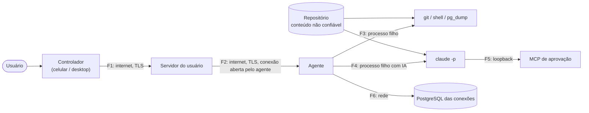

# Orquestração remota — modelo de ameaças

> **Estado: implementado (fase 2, E1 a E8).** Acompanha [`remote-orchestration.md`](remote-orchestration.md)
> e os ADR-084 a ADR-090 do [índice de ADRs](README.md). Os
> requisitos (RS-xx) são critérios de aceitação das entregas em
> [`../roadmap/phase-2-remote-orchestration.md`](../roadmap/phase-2-remote-orchestration.md);
> a seção 8 diz o teste de cada um, ou o risco aceito.

A fase 2 transforma o MyTaskApp num **executor remoto de código** na máquina do
usuário. Hoje, tudo o que roda foi pedido por alguém sentado na frente da
máquina. Este documento trata o novo caminho como o que ele é: um canal de
execução remota que precisa continuar seguro com o servidor comprometido, um
celular roubado ou um repositório malicioso.

## 1. Ativos

| Ativo | Onde | Por que importa |
|---|---|---|
| **Execução de código na máquina executora** | agente, como o usuário | quem executa, lê tudo o que o usuário lê: chaves SSH, cofres, cookies, credenciais de nuvem |
| Código-fonte e histórico Git | worktrees, repositórios | propriedade intelectual; um push indevido chega aos outros |
| Segredos do app | `ISecretStore` (DPAPI / libsecret): `sync`, `jira`, `mcp-access-token`, `postgres-*`, `device-key` | dão acesso à conta, ao Jira e aos bancos |
| Dados de produção | servidores PostgreSQL das conexões | vazamento de dado pessoal; a cópia só sai anonimizada (ADR-056/058) |
| Chaves dos dispositivos | `device-key` em cada máquina e no celular | quem assina, manda |
| Conta no servidor | OpenIddict, Google | controla a fila e a lista de dispositivos |
| Registro das operações | `RemoteOperations`, `RemoteOperationEvents` | a saída pode conter dados sensíveis |

## 2. Fronteiras de confiança

- **F1/F2**: o servidor fica no meio, mas **não é confiável para autorizar
  execução** (ADR-087). Ele é confiável só para disponibilidade e entrega.
- **F3/F4**: o processo filho tem os poderes do usuário. O worktree **não é
  sandbox**.
- **Repositório**: o conteúdo de um repositório (arquivos, `CLAUDE.md`,
  `.claude/settings.json`, scripts de build, hooks do Git) é **dado não
  confiável**, inclusive para quem tem a conta.

## 3. Atacantes considerados

| # | Atacante | Capacidade |
|---|---|---|
| T1 | Alguém na rede | lê e altera tráfego sem TLS; repete pacotes |
| T2 | **Servidor comprometido** (máquina invadida, backup vazado, admin malicioso) | lê e escreve o PostgreSQL, emite tokens, manda mensagens pelo hub |
| T3 | **Conta Google comprometida** | faz login, cria um dispositivo novo |
| T4 | **Celular roubado ou desbloqueado** | usa o app já logado |
| T5 | **Repositório ou dado malicioso** (prompt injection, `settings.json` do projeto, script de build) | influencia o Claude e os comandos |
| T6 | Processo local de outro usuário | tenta falar com o pipe, o MCP loopback ou ler o diário |
| T7 | O próprio usuário, por engano | aprova sem ler, deixa a máquina exposta |

## 4. Ameaças (STRIDE por fronteira)

| Id | Fronteira | Categoria | Ameaça | Mitigação | Requisitos |
|---|---|---|---|---|---|
| A-01 | F1/F2 | Spoofing | Servidor falso ou TLS interceptado | HTTPS/WSS obrigatório; issuer https (ADR-070); sem "aceitar certificado inválido" | RS-01, RS-02 |
| A-02 | F1 | Spoofing | Conta comprometida (T3) cria um controlador e manda operações | o controlador novo **não é confiável** para nenhum agente até ser pareado com código confirmado na máquina executora | RS-07, RS-08 |
| A-03 | F2 | Spoofing / Elevation | Servidor comprometido (T2) fabrica uma operação | o agente só aceita JWS ES256 de chave em `TrustedControllers`, gravada localmente; o servidor não tem nenhuma chave privada | RS-09, RS-10 |
| A-04 | F2 | Spoofing | Servidor comprometido troca a chave no pareamento | código curto derivado das duas impressões digitais e de um nonce, lido no controlador e digitado na máquina executora | RS-08 |
| A-05 | F1/F2 | Tampering | Alterar o payload de uma operação assinada | a assinatura cobre os bytes; o agente lê o que foi assinado, não uma cópia do servidor | RS-09 |
| A-06 | F2 | Repudiation / Replay | Reenviar uma operação antiga (rodar o deploy de novo) | `OperationId` único no diário (30 dias), `NotAfter`, `TargetDeviceId` e `WorkspaceId` dentro da assinatura | RS-11, RS-12 |
| A-07 | F2 | Replay | Reaproveitar uma aprovação antiga em outra operação | `ApprovalResponse` assinada com `ApprovalId`, `OperationId` e `RequestHash`; uso único; validade de 10 min | RS-13 |
| A-08 | F3 | Elevation | Injetar shell por parâmetro (`; rm -rf ~`) | só comando cadastrado, por id; valores remotos passam por `UnsafeCharacter` (o mesmo filtro dos valores de contexto) e por tamanho | RS-14, RS-15, RS-16 |
| A-09 | F3 | Elevation | Mudar o texto de um comando por sync e rodá-lo de longe (T2/T3) | `ICommandReviewGate` continua valendo; `RemoteAllowed` é coluna só local e **cai** quando o texto muda | RS-14, RS-17 |
| A-10 | F3 | Tampering | Diretório fora do worktree (`..`, caminho absoluto, link simbólico) | só ids; o caminho é resolvido no agente; `CommandWorkingDirectory.Normalize` já recusa `..` e absolutos; conferir que o resolvido fica sob o worktree | RS-18 |
| A-11 | F4 | Elevation | Prompt injection faz o Claude rodar `curl … \| sh` ou ler `~/.ssh` | perfil local com allowlist; Bash fora da lista pede aprovação humana; `permissions.deny` para caminhos sensíveis; ambiente sem segredos | RS-19 a RS-23 |
| A-12 | F4 | Elevation | `.claude/settings.json` do repositório libera ferramentas ou registra **hooks** (execução sem passar por permissão) | `--restricted` ignora os arquivos de configuração do usuário, do projeto e locais (conferido no 2.1.309); as regras do agente vão por `--settings` | RS-21 |
| A-13 | F4 | Elevation | Sessão remota herda `--dangerously-skip-permissions` do card (ADR-033) | o modo headless não lê os `DefaultArguments` do card; o agente recusa `bypassPermissions` e o flag em qualquer origem; o `--restricted` os recusa de novo, no próprio Claude | RS-19 |
| A-14 | F3/F4 | Elevation | Hook do Git (`post-checkout`) ou script de build malicioso no repositório | **fora do alcance do app**: é o mesmo risco de rodar o build localmente. Mitigação: só repositórios dos diretórios da etiqueta (cadastrados aqui) | RS-18, risco residual R-02 |
| A-15 | F5/T6 | Spoofing | Outro processo local chama o MCP de aprovação e se autoaprova | o MCP de aprovação só **pergunta** ao humano, não decide; loopback + `Host` + sem `Origin` + segredo por sessão (o padrão do `McpSecurityMiddleware`) | RS-24 |
| A-16 | IPC/T6 | Elevation | Outro usuário fala com o pipe do agente | `PipeOptions.CurrentUserOnly`; o pipe não aceita operação nem aprovação de controlador, só "dados mudaram", "sincronizar agora" e o pareamento local | RS-25 |
| A-17 | F6 | Information disclosure | Cópia de produção sem anonimizar pedida de longe | a mesma `DatabaseSecurityPolicy`, `PostgresProcessGuard` e PostgreSQL só leitura; produção pede aprovação com nome digitado; `RemoteAllowed` por conexão | RS-26, RS-27 |
| A-18 | F1/F2 | Information disclosure | Senha, token ou caminho no catálogo, nos eventos ou no log | catálogo só com ids e nomes; saída por `SensitiveText.Mask`; teste de reflexão como o `ContractSafetyTests` do MCP | RS-28, RS-29 |
| A-19 | F1 | Information disclosure | Access token na query string do WebSocket aparece em log | o `RequestLog` não registra a query de `/hubs/*`; o proxy também não | RS-03 |
| A-20 | F1/F2 | Denial of service | Inundar a fila ou o hub | rate limit `remote` por conta e por dispositivo; teto de operações abertas por executor; teto de eventos e bytes por operação | RS-30, RS-31 |
| A-21 | F3 | Denial of service | Processo que não termina, ou fork bomb | timeout por operação; Job Object (Windows) / grupo de processos (Linux); matar a árvore | RS-32 |
| A-22 | T4 | Elevation | Celular roubado aprova e manda operações | revogar o dispositivo de qualquer outro remove a chave dele de todos os agentes; destravar o app (biometria/PIN do sistema) antes de assinar | RS-33, RS-34 |
| A-23 | T7 | — | Aprovação por cansaço (aprovar tudo) | resumo legível e completo; "lembrar nesta sessão" só para a mesma ferramenta e padrão; produção exige digitar; nenhuma aprovação de "tudo" | RS-13, RS-35 |
| A-24 | F2 | Repudiation | Não saber quem mandou rodar o quê | auditoria nos dois lados, com o dispositivo que assinou; a assinatura guardada prova a origem | RS-36 |
| A-25 | Diário/T6 | Information disclosure | Saída sensível guardada no SQLite do agente | mascarada antes de gravar; sai do diário quando o servidor confirma; o registro da operação, sem a saída, fica 30 dias (a janela de replay) | RS-29 |

## 5. Requisitos

### Transporte

- **RS-01** HTTPS e WSS obrigatórios fora de Development; o agente recusa `http://`
  e `ws://` com servidor que não seja loopback (o `DevelopmentLoopbackGuard`
  já faz isso no servidor).
- **RS-02** Validação de certificado padrão do sistema, sem opção de ignorar.
- **RS-03** O access token nunca aparece em log: query de `/hubs/*` fora do
  `RequestLog` e fora do log do proxy.

### Credenciais por dispositivo, rotação e revogação

- **RS-04** Cada instalação tem **uma** identidade (`device_id`) e **uma** chave
  ES256 gerada localmente; a privada fica no `ISecretStore` (`"device-key"`) e
  nunca sai da máquina.
- **RS-05** Access token de 15 min e refresh com rotação, como hoje; o refresh
  roda sob trava entre processos (desktop e agente), relendo o cofre.
- **RS-06** Revogar um dispositivo (ADR-061) também tira a validade da chave
  dele em `DeviceKeys`; os agentes, no registro de cada minuto, esquecem o
  controlador que saiu da conta ou trocou de chave (`TrustedControllers`); um
  agente que ainda não registrou continua protegido, porque o servidor recusa
  o token do revogado (403 `device_revoked`). O agente só esquece pela lista
  da conta, nunca passa a confiar por ela.

### Autenticação, autorização e pareamento

- **RS-07** Escopo OAuth novo `remote`; endpoints remotos exigem `sync` + `remote`
  e dispositivo ativo (`DeviceFilter`).
- **RS-08** Pareamento com aprovação explícita **na máquina executora**, com o
  código curto derivado das duas impressões digitais. O pareamento expira em
  10 min. (Sem tela, pelo CLI do agente: não feito; R-09.)
- **RS-09** Toda operação e resposta de aprovação é um JWS ES256 conferido
  pelo agente contra `TrustedControllers`. O servidor confere também, mas não
  decide sozinho. O cancelamento não é assinado (R-08): só para, nunca começa.
  Desde a fase 3 (ADR-092), o agente confia também na própria instalação: o
  mesmo `DeviceId` e a chave do cofre. É o que deixa o desktop pedir a sessão
  gerenciada ao agente da mesma máquina (R-11).
- **RS-10** "Aceitar controle remoto" é ligado **só localmente**, vem
  desligado e não sincroniza.

### Replay e duplicação

- **RS-11** `OperationId` (UUIDv7) único no diário por 30 dias; o servidor
  recusa o mesmo id com outro conteúdo.
- **RS-12** `TargetDeviceId`, `WorkspaceId` e `NotAfter` (≤ 24 h) dentro da
  assinatura.
- **RS-13** Aprovação amarrada a `ApprovalId` + `OperationId` + `RequestHash`, de
  uso único e com validade; sem resposta, nega.

### Allowlist e validação

- **RS-14** Catálogo fechado de tipos de operação; nenhum campo do pedido é
  texto de shell, SQL ou argumento de linha de comando.
- **RS-15** `command.run` só por id de comando com `RemoteAllowed` nesta
  máquina; `RequiresConfirmation` vira aprovação.
- **RS-16** Valores de parâmetro vindos de fora passam por
  `CommandVariables.UnsafeCharacter` e por um teto de tamanho, como os valores
  de contexto.
- **RS-17** Alterar o texto de um comando (local ou por sync) desliga o
  `RemoteAllowed`; o `ICommandReviewGate` continua valendo.
- **RS-18** Diretório de trabalho só relativo ao worktree, resolvido no agente,
  sem `..`, sem absoluto e sem atravessar link simbólico para fora; repositório
  só de diretório de etiqueta mapeado aqui.

### Claude Code

- **RS-19** Nunca `--dangerously-skip-permissions` nem `--permission-mode
  bypassPermissions` numa sessão remota, venha de onde vier; os argumentos do
  card (ADR-033) não entram no modo headless. A sessão sempre roda com
  `--restricted`, que no Claude Code 2.1.309 recusa os dois já na leitura dos
  argumentos: é uma segunda trava, independente do código do agente.
- **RS-20** O perfil de permissões é escolhido e guardado **na máquina
  executora** (`--allowedTools`, `--disallowedTools`, `permissions.deny`); o
  controlador só escolhe entre os perfis do catálogo.
- **RS-21** Sem configurações nem hooks do projeto na sessão remota. O
  `--restricted` ignora os arquivos de configuração do usuário, do projeto e
  locais; as regras do agente entram só por `--settings`. O `--mcp-config` leva
  só o MCP de aprovação (`--strict-mcp-config`).
- **RS-22** Ferramenta fora do perfil vai para `--permission-prompt-tool`, que
  vira `ApprovalRequest`; sem resposta, nega. Um perfil sem canal de aprovação
  usa `--permission-prompts none`, que nega tudo o que perguntaria.
- **RS-22a** Cada prompt tem teto de turnos (`--max-turns`) e de custo
  (`--max-budget-usd`), definidos na máquina executora.
- **RS-23** Ambiente do processo sem segredos: fora `MYTASKAPP_*` (exceto o
  segredo da própria sessão), `PG*`, `GH_TOKEN`, `GITHUB_TOKEN` e afins; o
  prompt vai pelo stdin, e não pela linha de comando.

### Processos e IPC

- **RS-24** MCP de aprovação: loopback, `Host` conferido, `Origin` recusado,
  segredo por sessão (só o hash guardado), que morre com o processo.
- **RS-25** Pipe local só do usuário (`CurrentUserOnly`), sem nenhuma
  capacidade de execução.

### Banco de dados

- **RS-26** A cópia remota passa por `RunDatabaseCopyHandler` com a mesma
  política, as mesmas etapas e a mesma auditoria; nenhuma via paralela.
- **RS-27** Conexão só no catálogo com `RemoteAllowed` local; origem de produção
  pede `ApprovalKind.ProductionDatabase`, com o nome digitado quando
  `CriticalProduction`; nenhuma operação remota cria, edita ou lê conexão ou
  senha.

### Sigilo

- **RS-28** Catálogo, eventos e resultados sem caminho absoluto, host, usuário,
  senha, token ou texto de comando; um teste de reflexão sobre os contratos.
- **RS-29** Toda saída passa por `SensitiveText.Mask` antes do diário e do
  servidor; a saída sai do diário quando o servidor confirma; o servidor guarda
  no máximo 10 000 eventos de até 8 KiB por operação (acima, a saída é
  confirmada e descartada, e o fim nunca se perde) e 30 dias. Desde a fase 3
  (E9), a operação terminada há 30 dias sai inteira, com as aprovações, e o
  pedido de pareamento vencido também. Do Claude sem
  terminal, desde a fase 3 (E7), vai também a saída dos comandos dele (Bash e
  PowerShell), mascarada e cortada; o resultado das outras ferramentas (o
  conteúdo de um arquivo lido, uma busca) não sai da máquina.

### Limites

- **RS-30** Rate limit `remote` por conta (separado de `sync`, ADR-069) e por
  dispositivo controlador.
- **RS-31** Por executor: 3 operações simultâneas e 120 por hora de cada
  controlador, no agente; 20 abertas, no servidor, contadas e gravadas sob uma
  trava por máquina (fase 3, E9). As "pesadas" têm a trava
  delas: uma operação de banco por vez no computador (o gate e o lease entre
  processos) e um Claude por worktree.
- **RS-32** Timeout por operação e morte da árvore de processos, inclusive
  quando o agente cai.

### Controlador

- **RS-33** Assinar exige destravar o dispositivo (biometria/PIN do sistema no
  celular; no desktop, a sessão do usuário).
- **RS-34** Revogar de qualquer dispositivo confiável funciona mesmo com o
  revogado desligado.
- **RS-35** A tela de aprovação mostra o pedido inteiro (ferramenta, comando
  completo, diretório), não só um resumo.
- **RS-37** O aviso com o app fechado (ADR-096) só lê: responder continua
  pedindo a tela e o destravamento. O resumo do pedido fica escondido na tela
  bloqueada (`VisibilityPrivate`, com uma versão pública sem conteúdo), e o
  toque só abre a aba Remoto, a única rota que a tela de entrada aceita.

### Auditoria

- **RS-36** Toda operação deixa rastro: no servidor (pedido assinado, estados,
  quem), no agente (`ITaskAuditLog` com a origem `"Remoto: <dispositivo>"`) e,
  no banco, a `DatabaseOperationAudit` de sempre.

## 6. O que fica igual nas operações de banco

Nenhuma barreira do ADR-056 é afrouxada:

- o teto e o piso de cada ambiente (`EnvironmentPolicy`);
- `Evaluate` antes e `Demand` em cada etapa (`DatabaseCopyRun`);
- `PostgresProcessGuard` nos argumentos reais;
- a sessão só leitura no PostgreSQL de origem;
- a senha só por `PGPASSWORD`, lida no executor;
- a auditoria gravada antes do primeiro processo.

O que muda é **quem confirma**: em vez do diálogo da tela, uma
`ApprovalResponse` assinada, com o nome digitado quando a política exige.

## 7. Riscos residuais

| Id | Risco | Por que fica | Como reduzir depois |
|---|---|---|---|
| R-01 | O Claude com Bash aprovado roda **como o usuário** e alcança tudo | worktree não é sandbox; o SO não isola por pasta | sandbox do SO (contêiner, AppContainer, bubblewrap) como perfil opcional |
| R-02 | Build e hooks do Git do repositório rodam código | é o mesmo risco de rodar o build localmente | só repositórios cadastrados; documentar |
| R-03 | Prompt injection (inclusive pelo `CLAUDE.md` do repositório) convence o usuário a aprovar | o humano é a última barreira | resumo completo, nenhum "aprovar tudo"; um perfil "endurecido" com `--safe-mode` (sem `CLAUDE.md`, skills, plugins nem hooks) para repositórios de terceiros |
| R-04 | Servidor comprometido vê saídas e nomes | o servidor guarda os eventos para quem não estava conectado | cifrar ponta a ponta os eventos (chave do controlador) numa versão futura |
| R-05 | Celular desbloqueado nas mãos de outro | a chave está no aparelho | biometria antes de assinar; revogação rápida |
| R-06 | O agente roda com a sessão do usuário aberta | DPAPI e libsecret são do usuário | cofre de máquina, se um dia rodar sem logon |
| R-07 | Disponibilidade depende do servidor do usuário | é o desenho do ADR-078 | nada: sem servidor, nada remoto, e o local segue inteiro |
| R-08 | O cancelamento não é assinado: um servidor comprometido pode parar uma operação | parar é sempre o lado seguro (a etapa crítica termina antes, 4.7), e assinar o cancelamento pediria o destravamento no celular para parar algo. Reavaliado na fase 3 (E9) e mantido: o mesmo servidor já pode segurar ou descartar qualquer pedido, então a assinatura não tira dele nada que ele não tenha | `CancelRequest` assinado, se parar de propósito virar um dano |
| R-09 | Uma máquina sem tela não pareia | o código é confirmado na janela Máquinas | o `pair` no CLI do agente, lendo o código no terminal |
| R-11 | A própria instalação pede e aprova sem pareamento (ADR-092) | quem lê a chave do cofre já roda tudo nesta máquina como o usuário; o servidor sozinho não tem a chave | desligar "aceitar controle" corta também a própria; a origem aparece como "Remoto: este computador" na auditoria |
| R-10 | O log de acesso do proxy guarda a query do hub | o proxy é do usuário | a nota no `sync-server.md` (o filtro do Caddy); os apps já mandam o token no cabeçalho |

## 8. Verificação (T-36)

Cada requisito com o teste que o cobra, e o que fica sem teste com o motivo.
"Aceito" é um risco da seção 7, ou uma parte que nenhum teste automatizado
consegue provar.

| RS | Teste | Sem teste (aceito) |
|---|---|---|
| RS-01 | `SyncServerUrlTests` (http e `ws://` para fora do loopback recusados), `DevelopmentLoopbackTests` | o hub usa o mesmo endereço já validado; o HTTPS do servidor é o do ADR-070 |
| RS-02 | `NoCertificateBypassTests` (nenhum código troca a validação do certificado) | — |
| RS-03 | `RemoteHubTests.ATokenInTheQuery_OnlyAuthenticatesTheHub_AndIsNeverLogged` | o log do proxy é do usuário (R-10) |
| RS-04 | `DeviceKeyStoreTests`, `RemoteDeviceTests` (desktop e agente com uma chave só) | — |
| RS-05 | `ApiTests` (15 min, rotação do refresh), `TwoProcessSyncTests` | — |
| RS-06 | `RemoteOperationTests.ARevokedMachine_IsNeitherATargetNorAnAgent`, `RemotePairingTests.AControllerRevokedBeforeTheApproval_CannotBePaired` (a chave do revogado não vale), `RemoteMachinesTests.AnExecutor_ForgetsTheControllersRevokedOnTheAccount_OrWithAnotherKey`, `RemoteOperationsEndToEndTests.Chaos_ARevokedMachine_StopsWhatRuns_AndStopsAccepting` | — |
| RS-07 | `RemoteScopeTests`, `RemoteHubTests.WithoutTheRemoteScopeOrAToken_TheHubRefuses` | — |
| RS-08 | `ConfirmPairingHandlerTests` (código errado, chave trocada), `RemotePairingTests` (mesmo código dos dois lados, expirado dá 410) | o CLI sem tela (R-09) |
| RS-09 | `AdmitRemoteOperationTests` (chave não pareada, bytes mexidos; a própria instalação só com o id e a chave dela), `RemoteOperationTests.ASignatureThatIsNotTheCallersActiveKey_IsRefused`, `RemoteApprovalsTests` | o cancelamento (R-08) |
| RS-10 | `AdmitRemoteOperationTests`, `ConfirmPairingHandlerTests` (desligado, nada entra) | vem desligado e fica fora do `SyncRegistry` (`RemoteExecutionSettings`, seção 2.4 da arquitetura) |
| RS-11 | `RemoteOperationTests.TheSameEnvelopeTwice_IsTheSameOperation_AndAnotherRequestWithTheSameId_IsRefused`, `RemoteOperationJournalTests`, `Chaos_DuplicatedRequestsAndEvents_RunAndCountOnce` | — |
| RS-12 | `RemoteJwsTests`, `AdmitRemoteOperationTests` (outro alvo, outra conta), `RemoteOperationTests` (`NotAfter` acima de 24 h) | — |
| RS-13 | `RemoteApprovalsTests` (hash, id, prazo, chave e revogado), `RemoteApprovalTests` (uso único), `Chaos_AnApprovalNobodyAnswers_IsDeniedAtTheDeadline` | — |
| RS-14 | `RemoteOperationRulesTests`, `ContractSafetyTests` | — |
| RS-15 | `CommandRunExecutorTests` (não liberado não roda; confirmação vira aprovação) | — |
| RS-16 | `CommandRunExecutorTests` (metacaracteres de shell recusados) | — |
| RS-17 | `CommandRemoteAllowedTests`, `CommandRemoteAllowedSyncTests`, `CommandRunExecutorTests` | — |
| RS-18 | `CommandVariablesTests` (`..` e absoluto), `RemoteProvisionPlannerTests` (diretório não mapeado aqui) | o link simbólico para fora: o worktree é criado pelo Git a partir de repositório cadastrado (R-02) |
| RS-19 | `ClaudeCodeHeadlessLaunchTests` (`--restricted`, nada de "dangerously", sem os argumentos do card) | — |
| RS-20 | `ClaudeCodeHeadlessLaunchTests`, `AgentSessionExecutorsTests` (perfil desconhecido recusado) | — |
| RS-21 | `ClaudeCodeHeadlessLaunchTests` (`--restricted`, `--settings`, `--strict-mcp-config`) | ignorar os hooks é do próprio Claude Code com `--restricted` (conferido no 2.1.309, opt-in `ApprovalClaudeTests`) |
| RS-22 | `ClaudeCodeHeadlessLaunchTests` (`--permission-prompts none`), `AgentSessionExecutorsTests` (vira aprovação; sem resposta, nega) | — |
| RS-22a | `AgentSessionExecutorsTests` (o pedido só baixa os tetos), `ClaudeCodeHeadlessLaunchTests` | — |
| RS-23 | `ClaudeCodeHeadlessLaunchTests`, `HeadlessAgentRunnerTests` (ambiente real; prompt pelo stdin) | — |
| RS-24 | `ApprovalMcpServerTests` (sem segredo 401, `Origin` 403, outro `Host` 400, segredo morto ao fechar) | — |
| RS-25 | `PipeLocalPeerChannelTests` (nenhum pedido de execução atendido) | o `CurrentUserOnly` é o do .NET no servidor do pipe |
| RS-26 | `DatabaseCopyExecutorTests` (o mesmo `RunDatabaseCopyHandler`, etapas e auditoria) | — |
| RS-27 | `DatabaseCopyExecutorTests` (conexão não liberada; produção aprova; crítica digita), `RemoteApprovalsTests` | — |
| RS-28 | `ContractSafetyTests` (reflexão sobre os contratos), `RemoteCatalogQueryTests` | — |
| RS-29 | `CommandRunExecutorTests` (saída mascarada e cortada), `RemoteOperationTests.AboveTheCeiling_OutputIsAcknowledgedButDropped_AndTheRestIsKept`, `RemoteOperationTests.OldEvents_AreSweptAway` | — |
| RS-30 | `RemoteDeviceTests` (cota própria, por dispositivo) | — |
| RS-31 | `AdmitRemoteOperationTests` (teto de simultâneas), `RemoteOperationTests.AMachineWithTwentyOpenOperations_RefusesTheNext_UntilOneEnds`, `SqliteProcessLeasesTests` (uma cópia por vez) | — |
| RS-32 | `KillOnCloseJobTests` (o neto morre com o job, no Windows), `ShellCommandExecutorTests` (timeout mata), `Chaos_ACommandKilledFromOutside_FailsWithTheReason` | o grupo de processos do Linux: CI do Linux |
| RS-33 | `RemoteTests` do celular (assina só destravado, tranca em segundo plano, sem bloqueio de tela não assina) | o desktop: a sessão do usuário |
| RS-34 | `RemoteDeviceTests`, `RemoteOperationTests.ARevokedMachine_IsNeitherATargetNorAnAgent` (revoga com o alvo parado) | — |
| RS-35 | `AgentSessionExecutorsTests` (o comando inteiro no resumo), `RemoteTests` do celular | — |
| RS-36 | `RemoteOperationAuditTests` ("Remoto: Pixel 8"), `DatabaseCopyExecutorTests` (`ConfirmedBy`), `RemoteOperationTests` (o servidor guarda os bytes assinados) | a operação sem tarefa fica no diário do agente e no servidor, não no `ITaskAuditLog` |
| RS-37 | `RemoteBackgroundCheckTests` do celular (só lê, avisa uma vez, nada com a tela na frente) | a notificação escondida na tela bloqueada e a rota do toque: só num aparelho Android |
