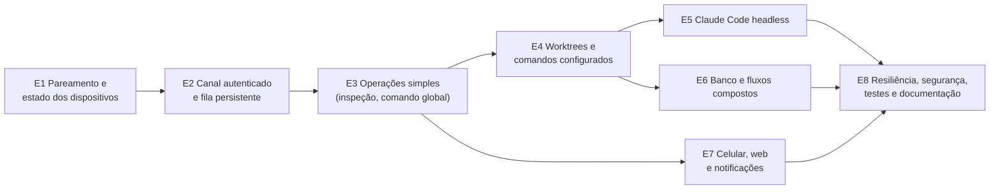

# Fase 2 — Orquestração remota: roteiro de implementação

> **Estado: em implementação.** As tarefas feitas estão marcadas com ✔ na lista
> do fim, com o commit de cada uma. A arquitetura está em
> [`../architecture/remote-orchestration.md`](../architecture/remote-orchestration.md),
> as ameaças e os requisitos RS-xx em
> [`../architecture/remote-security-threat-model.md`](../architecture/remote-security-threat-model.md)
> e as decisões nos ADR-084 a ADR-090 de [`../ARCHITECTURE.md`](../ARCHITECTURE.md).

## Princípios do roteiro

- **Cada entrega vale sozinha** e vai para a master atrás de "Aceitar controle
  remoto", que vem desligado. Quem não liga nada não vê diferença.
- **Offline-first intacto**: sem servidor, o desktop é exatamente o de hoje.
- **Refatorar antes de expor**: regra que só existe na tela desce para a
  Application num PR próprio (`refactor:`), com os testes da tela verdes, antes
  de qualquer uso remoto.
- **A primeira versão útil** (fim da entrega 4) controla **dois computadores
  reais**, Windows e Linux, **com o desktop fechado na máquina executora**.
- Commits e PRs seguem `docs/release-process.md` (Conventional Commits; o
  Release Please sobe a versão).

## Visão das entregas

| Entrega | Resultado visível | Depende de |
|---|---|---|
| E1 | lista "Máquinas" com online/offline, capacidades e pareamento com código | — |
| E2 | o agente sobe sem o desktop e responde a `environment.inspect` | E1 |
| E3 | rodar um comando liberado em outra máquina e ver a saída ao vivo; aprovar uma confirmação | E2 |
| E4 | **v1**: preparar o worktree de uma tarefa e rodar os comandos dele de longe | E3 |
| E5 | mandar um prompt ao Claude Code de longe, acompanhar e aprovar ferramentas | E4 |
| E6 | cópia de banco do ambiente de longe; "preparar tudo" numa operação só | E4 |
| E7 | tudo isso pelo celular | E3 (telas), E5/E6 (recursos) |
| E8 | testes de caos, revisão de segurança, guia do usuário | todas |

---

## E1 — Pareamento, registro e estado dos dispositivos

**Escopo**

- Escopo OAuth `remote` no OpenIddict e nos dois clientes; reconsentimento uma
  vez (ADR-087). O lado do servidor já está feito (T-02); o cliente só passa a
  pedir o escopo ao ligar o remoto (T-06), porque um servidor antigo recusa o
  login inteiro com `invalid_scope`.
- Chave ES256 por instalação, privada no `ISecretStore` (`"device-key"`).
- Servidor: `DeviceKeys`, `DeviceCapabilities` (papéis, protocolo, ferramentas,
  `LastHeartbeatAt`), `RemotePairings`; persistir o que hoje o
  `DeviceHello.Capabilities` descarta.
- Endpoints `PUT /api/v1/remote/devices/current`, `GET /api/v1/remote/devices`,
  `POST /api/v1/remote/pairings`, `GET|POST /api/v1/remote/pairings/{id}[/approve]`.
- Rate limiter `remote` separado de `sync` (ADR-069).
- Desktop: janela "Máquinas" (lista, online/offline, parear, revogar) e a
  confirmação do código do lado executor (por enquanto no próprio desktop).
- Projeto `MyTaskApp.Remote.Contracts` com os contratos de dispositivo e
  pareamento, e uma regra no `LayerDependencyTests`.

**Arquivos prováveis**

- `src/MyTaskApp.Remote.Contracts/*` (novo)
- `src/MyTaskApp.Server.Api/ServerSetup.cs` (escopo, limiter),
  `RemoteApiEndpoints.cs` (novo), `ConnectEndpoints.cs` (escopo no consentimento)
- `src/MyTaskApp.Server.Application/RemoteDevices.cs` (novo)
- `src/MyTaskApp.Server.Infrastructure/Persistence/ServerRows.cs`,
  `ServerDbContext.cs`, migration nova
- `src/MyTaskApp.Infrastructure/Remote/DeviceKeyStore.cs` (novo),
  `Sync/Http/SyncAuthenticationService.cs` (escopo)
- `src/MyTaskApp.Infrastructure/Persistence`: `TrustedControllers` e
  `RemoteExecutionSettings` + migration local
- `src/MyTaskApp.Desktop/ViewModels/MachinesViewModel.cs`, `Views/MachinesWindow.axaml` (novos)

**Testes**

- `Server.IntegrationTests`: escopo exigido; dispositivo revogado não registra
  chave; pareamento expira; código igual nos dois lados; outra conta não vê.
- `Infrastructure.Tests`: a chave sobrevive a reabrir; a privada nunca vai
  para o banco; a impressão digital é estável.
- `Sync.Contracts.Tests`/`Remote.Contracts.Tests`: JSON de ida e volta;
  nenhum contrato tem campo de senha, caminho ou host (reflexão).
- `UpgradePreservationTests`: as tabelas locais novas não entram no
  `SyncRegistry` (o teste de classificação de colunas do ADR-061 acusa).

**Riscos**: o reconsentimento pode confundir quem já usa o sync (mitigação:
pedir só ao ligar o remoto). O código curto precisa de entropia suficiente
(6 dígitos + nonce + validade curta).

**Critérios de aceitação**

- [ ] Dois computadores na mesma conta se veem em "Máquinas" com
      plataforma, versão e "online há X s".
- [ ] Parear exige o código confirmado na máquina executora; com o código
      errado, nada é gravado.
- [ ] Revogar some com a máquina da lista dos outros em até 30 s.
- [ ] Sem ligar o remoto, nenhuma tabela nova é escrita e o sync é o de hoje.

---

## E2 — Canal remoto autenticado e fila persistente

**Escopo**

- **Agente**: projeto `MyTaskApp.Agent` (console, net10.0), composto como o
  `McpTestHost` (`AddApplication` + `AddInfrastructure`), com mutex próprio
  `MyTaskApp.Agent` e `ICurrentUser` e `IAlertPresenter` próprios (sem UI).
- **SQLite para dois processos** (ADR-085): ~~WAL e migrate sob trava~~ feitos
  na T-07 (o WAL já existia pelo EF, a trava de migration é do próprio EF);
  ~~a tabela `ProcessLeases`, o ciclo do sync só no dono do lease e o refresh
  do token sob trava entre processos~~ feitos na T-08.
- ~~Mover `ScopedUseCaseRunner`~~ feito na T-09: está em
  `Application/Abstractions`, e o `AddApplication` o registra para todo host.
- **IPC local**: named pipe `CurrentUserOnly` (Unix socket no Linux): "dados
  mudaram", "sincronizar agora", pareamento local.
- **Servidor**: `RemoteOperations`, `RemoteOperationEvents` + migration; REST de
  operação (criar, ler, eventos, aceitar, recusar, concluir, cancelar); hub
  `/hubs/remote`; varredura de expiração (`BackgroundService`, como o
  `ProcessedOperationsPruner`).
- **Diário do agente**: `RemoteOperationJournal`, `RemoteOperationJournalEvents`.
- **Primeira operação**: `environment.inspect` (Git, Claude, gh, ferramentas
  PostgreSQL, catálogo). Não muda nada na máquina.
- **Instalação**: tarefa agendada no logon (Inno Setup) e unit
  `systemd --user` (`install.sh`); o instalador fecha e reabre o agente.

**Arquivos prováveis**

- `src/MyTaskApp.Agent/*` (novo): `Program.cs`, `AgentServices.cs`,
  `RemoteChannel.cs` (hub + REST), `OperationDispatcher.cs`
- `src/MyTaskApp.Application/Remote/*` (novo): `IRemoteOperationHandler<T>`,
  `RemoteOperationJournal` (porta), `InspectEnvironmentHandler`
- `src/MyTaskApp.Infrastructure/Persistence/DatabaseOptions.cs`,
  `DatabaseInitializer.cs`, migration local
- `src/MyTaskApp.Infrastructure/Remote/*` (novo): cliente HTTP/SignalR,
  verificador de JWS, `ProcessLeaseStore`, `LocalPipeServer`
- `src/MyTaskApp.Desktop/Composition/AppServices.cs`, `App.axaml.cs` (lease,
  pipe)
- `src/MyTaskApp.Server.Api/RemoteOperationEndpoints.cs`, `RemoteHub.cs` (novos)
- `src/MyTaskApp.Server.Application/RemoteOperations.cs` (novo)
- `installer/windows/MyTaskApp.iss`, `installer/linux/payload/install.sh`
- `Directory.Packages.props`: `Microsoft.AspNetCore.SignalR.Client`

**Testes**

- `Infrastructure.Tests`: **dois processos** (ou duas conexões sem
  compartilhamento) escrevendo ao mesmo tempo, sem `SQLITE_BUSY` visível; o
  lease troca de dono quando o processo morre; migrate concorrente roda uma vez.
- `Application.Tests`: dispatcher recusa assinatura inválida, alvo errado,
  `NotAfter` vencido, id repetido, tipo desconhecido.
- `Server.IntegrationTests`: criar é idempotente (mesmo id/hash → mesma
  operação; outro hash → 409); `Dispatched` sem aceite volta a `Queued`;
  `Expired` no `NotAfter`; eventos com `Seq` repetido ignorados; ack devolve o
  contíguo; transição inválida recusada; revogar derruba o hub.
- Ponta a ponta (como o `TwoDeviceSyncTests`): um desktop controlador e um
  agente contra o servidor real; o agente responde `environment.inspect` com o
  desktop **fechado**.
- `Packaging.Tests`: o instalador registra e remove a tarefa agendada / unit.

**Riscos**

- Backup que copia só o `.db` perde o que ainda está no `-wal`. Não é risco
  novo (o banco sempre esteve em WAL, ver T-07), mas dois processos abertos o
  tornam mais provável. Mitigação: a nota em "Onde ficam os dados" do README.
- O desktop deixa de ser dono do sync quando o agente está vivo: a bolinha
  (ADR-063) passa a ler o estado do banco e pedir "agora" pelo pipe.
- Proxy sem WebSocket: o fallback REST (30 s) precisa ser testado.

**Critérios de aceitação**

- [ ] Com o desktop **fechado** no computador B (Windows) e no C (Linux), o
      desktop A vê os dois online e recebe o `environment.inspect` de cada um
      em menos de 5 s.
- [ ] Desligar o Wi-Fi de B por 2 min e religar: a operação pedida nesse
      intervalo roda quando ele volta (se dentro do `NotAfter`) ou expira, e
      nenhum evento se perde.
- [ ] Abrir e fechar o desktop B com o agente rodando não duplica lembretes
      nem ciclos de sync.
- [ ] Nenhuma porta de entrada nova em B ou C (`netstat`: só loopback e
      conexões de saída).

---

## E3 — Execução remota de operações simples

**Escopo**

- `command.run` para **comandos globais e de diretório** com `RemoteAllowed`
  (coluna local, que cai quando o texto muda).
- ~~`RequiresConfirmation` cobrado no caso de uso~~ feito na T-18
  (`RunQuickCommand.Confirmed`). Falta o agente marcar o pedido só depois de
  uma aprovação remota.
- Aprovação: `RemoteApprovals` no servidor; `ApprovalRequest`/`ApprovalResponse`
  assinada; validade e negação por padrão.
- Saída ao vivo: `ICommandExecutor` → eventos `Output` mascarados, em lote.
- Cancelamento: `CancelRequestedAt` → `CancellationToken` → morte da árvore.
- Job Object (Windows) / grupo de processos (Linux) por operação.
- Recuperação após reinício do agente (seção 4.5 da arquitetura).
- Origem `"Remoto: <dispositivo>"` e auditoria de comando no `ITaskAuditLog`.

**Arquivos prováveis**

- `src/MyTaskApp.Domain/Commands/DevelopmentCommand.cs` (só a regra de "o
  texto mudou, cai a liberação"), mapeamento local no EF
- `src/MyTaskApp.Application/Remote/RunCommandRemotely.cs` (marca `Confirmed`
  só depois da aprovação)
- `src/MyTaskApp.Infrastructure/Processes/*` (Job Object / grupo)
- `src/MyTaskApp.Server.*` (aprovações)
- Desktop A: tela "Operação" (saída ao vivo, cancelar, aprovar): feita, em
  `RemoteControlWindow`, aberta por "Controlar" na janela Máquinas. Escolhe
  pelos ambientes prontos que o catálogo traz (`AgentCatalog.Environments`, só
  ids; o título e a branch vêm do sync)

**Testes**

- `QuickCommandHandlersTests`: sem confirmação, o caso de uso recusa (antes só a
  tela recusava); `QuickCommandsViewModelTests` continuam verdes.
- `CommandReviewSourcesTests`: comando alterado em outro computador é recusado
  também quando pedido de longe.
- Comando sem `RemoteAllowed` → `Rejected`; parâmetro com `;` ou `&` → recusado.
- Cancelar mata a árvore (neto incluso, como o `ProcessRunnerGrandchildTests`).
- Agente morto no meio: o filho morre junto e a operação fica `Interrupted`.
- Aprovação: resposta com `RequestHash` de outra → recusada; usada duas vezes →
  recusada; expirada → nega.

**Riscos**: tornar `RequiresConfirmation` obrigatório no caso de uso muda a
tela (refatoração com teste). Saída muito grande: teto por operação.

**Critérios de aceitação**

- [x] De A, rodar em B um comando global liberado e ver a saída linha a linha
      com menos de 1 s de atraso (o agente manda a cada 500 ms; a tela
      "Operação", `RemoteControlWindow`, lê a cada 500 ms).
- [x] Um comando com "pedir confirmação" para em `WaitingApproval` até
      alguém aprovar em A.
- [x] Cancelar em A encerra o processo em B em até 5 s.
- [x] Um comando não liberado nunca roda, nem com a operação forjada direto no
      banco do servidor (teste com o servidor "comprometido").

---

## E4 — Preparação de worktrees e comandos configurados (v1)

**Escopo**

- **Refatoração primeiro** (PR `refactor:` próprio): extrair a sequência de
  `TaskDevelopmentViewModel.StartAsync/CreateAsync` para
  `ProvisionEnvironmentHandler` na Application, com as decisões como dados
  (`WorktreeConflictPolicy`, confirmação de produção por porta). O ViewModel
  passa a chamá-lo.
- `worktree.provision` (preparar → worktree → comandos pós-worktree), com
  checkpoints e retomada (`AdoptExisting`).
- `worktree.remove` (aprovação obrigatória).
- `command.run` dentro do worktree (comandos rápidos, ADR-051).
- Tarefa criada no controlador: `RequiredEntities` faz o agente sincronizar e
  esperar a tarefa chegar (até 2 min).
- Clone no agente sem janela de login (`GCM_INTERACTIVE=Never`).
- Desktop A: "Preparar em…" na aba Desenvolvimento de uma tarefa.

**Arquivos prováveis**

- `src/MyTaskApp.Application/Development/ProvisionEnvironment.cs` (novo)
- `src/MyTaskApp.Desktop/ViewModels/TaskDevelopmentViewModel.cs`,
  `DevelopmentDatabaseViewModel.cs`
- `src/MyTaskApp.Application/Remote/ProvisionEnvironmentRemotely.cs`,
  `RemoveWorktreeRemotely.cs`
- `src/MyTaskApp.Infrastructure/Git/GitClient.cs` (clone sem prompt, por opção)

**Testes**

- `TaskDevelopmentViewModelTests` e `TaskDevelopmentsViewModelTests` **sem
  mudança de expectativa** (prova de que a refatoração não mudou o produto).
- `ProvisionEnvironmentHandlerTests`: cada política de conflito; falha em
  cada etapa; retomada adota o worktree existente; tarefa ausente espera e
  depois falha com mensagem.
- `GitWorktreeIntegrationTests` com o fluxo remoto.
- Ponta a ponta: A pede, B (desktop fechado) cria o worktree; o ambiente
  aparece em A como `NotCreatedHere` pelo sync, como já acontece hoje.

**Riscos**: o `TaskDevelopmentViewModel` tem 2009 linhas; a extração é a
parte mais delicada do roteiro (mitigação: PR só de refatoração, sem mudança de
comportamento, como em `docs/refactoring/PROGRESS.md`).

**Critérios de aceitação (v1)**

- [ ] No celular ou em A: criar uma tarefa, escolher B, escolher o
      repositório e a branch de origem, e B cria o worktree e roda os comandos
      pós-worktree, **com o desktop de B fechado**, em Windows e em Linux.
      (Em A, no Windows: feito, T-23 e T-25. O celular vem na E7; o Linux, no
      CI.)
- [x] Derrubar o agente de B durante o `git worktree add` e religar: a
      operação termina ou fica `Interrupted` com a etapa dita; "Repetir" adota
      o worktree já criado (a queda real, com o processo morto, fica para os
      testes de caos da T-35).
- [x] Remover o worktree de longe exige aprovação e recusa se houver sessão do
      Claude ativa (regra existente).

---

## E5 — Execução e acompanhamento do Claude Code

**Escopo**

- **Conferir primeiro, com o modelo de verdade**, num teste opt-in
  `MYTASKAPP_TEST_CLAUDE=1` (como o ADR-081 fez):
  - o formato dos eventos do `stream-json`;
  - o contrato da ferramenta de `--permission-prompt-tool`.

  Os flags já foram conferidos no 2.1.309 sem chamar o modelo (arquitetura,
  seção 7). `--permission-prompt-tool` e `--max-turns` são aceitos mas não
  aparecem na ajuda: o teste os cobre, e o `DetectAsync` exige a versão
  mínima conferida.
- Base da linha de comando: `-p --restricted`, `--tools` do perfil,
  `--strict-mcp-config` e `--settings` gerado pelo agente (seção 2.5 da
  arquitetura); `--max-turns` e `--max-budget-usd` com teto local.
- `IHeadlessAgentProvider` no `ClaudeCodeCliProvider`; prompt pelo stdin (sem a
  limitação de `"` e `%` do `claude.cmd`).
- `AgentSession.Mode` (Interativo/Headless), status `Stopped`,
  `RemoteOperationId`; migration local.
- Perfis locais (leitura; editar no worktree; editar + comandos de teste),
  com `--allowedTools`, `--disallowedTools` e `permissions.deny`.
- MCP de aprovação no agente (o padrão do `McpSecurityMiddleware`, segredo por
  sessão) → `ApprovalRequest` → resposta assinada.
- `agent.start`, `agent.prompt` (`--resume`), `agent.stop`.
- Eventos `AgentMessage`, `ToolUse`, `Result` (custo, turnos) a partir do
  `stream-json`; `AgentActivity` derivada (esperando aprovação = esperando você).
- Desktop A: painel da sessão remota (conversa, ferramentas, aprovar/negar).

**Arquivos prováveis**

- `src/MyTaskApp.Application/Agents/IHeadlessAgentProvider.cs`,
  `AgentSessionHandlers.cs` (modo headless)
- `src/MyTaskApp.Domain/Agents/AgentSession.cs`
- `src/MyTaskApp.Infrastructure/Agents/ClaudeCode/ClaudeCodeCliProvider.cs`,
  `ClaudeStreamJsonReader.cs` (novo)
- `src/MyTaskApp.Agent/Approvals/ApprovalMcpServer.cs` (novo)

**Testes**

- `ClaudeCodeCliProviderTests`: os `DefaultArguments` do card nunca aparecem no
  headless; `bypassPermissions` recusado; `--restricted` sempre presente;
  ambiente sem `PG*`, `GH_TOKEN` e `MYTASKAPP_*` alheios; o `--settings`
  gerado é JSON válido (o `-p` ignora em silêncio um arquivo inválido).
- `ClaudeStreamJsonReaderTests` com saídas gravadas da versão conferida.
- Aprovação: negar devolve `deny` ao Claude; expirar nega; o MCP recusa sem o
  segredo, com `Origin` e fora do loopback.
- `AgentSessionTests`: `Stopped` só a pedido; reconciliação com o processo morto.
- Opt-in com o Claude real: uma pergunta de leitura termina sem aprovação; um
  `Bash` fora do perfil para em `WaitingApproval`.

**Riscos**: mudanças de flags entre versões do Claude Code (mitigação: versão
mínima conferida no `DetectAsync`; recusa com mensagem clara). Prompt injection
(risco residual R-03).

**Critérios de aceitação**

- [x] Do celular ou de A, mandar um prompt para a tarefa em B; ver a resposta e
      as ferramentas usadas ao vivo. (De A; o celular vem na E7.)
- [x] Uma ferramenta fora do perfil aparece para aprovação; negar faz o Claude
      seguir sem ela. (Com o Claude falso; com o real, falta o login: T-26.)
- [x] Um segundo prompt continua a mesma conversa (`--resume`).
- [x] "Parar" encerra o processo e a sessão fica `Stopped`.
- [x] Em nenhum caminho o processo recebe `--dangerously-skip-permissions`.

---

## E6 — Operações de banco e fluxos compostos

**Escopo**

- `database.copy` por ids do catálogo (conexões com `RemoteAllowed` local).
- Confirmação de produção e nome digitado por `ApprovalKind.ProductionDatabase`.
- `DatabaseOperationGate` e `RecoverInterruptedDatabaseOperationsHandler` entre
  processos (dono = PID + início na auditoria).
- `worktree.provision` com a cópia de banco do ambiente (ADR-060) e,
  opcionalmente, `agent.start` no fim: "preparar tudo" numa operação.

**Arquivos prováveis**

- `src/MyTaskApp.Application/DatabaseOperations/CopyHandlers.cs` (confirmação por
  porta), `ProfileHandlers.cs` (gate entre processos)
- `src/MyTaskApp.Domain/DatabaseOperations/DatabaseOperationAudit.cs` (dono)
- `src/MyTaskApp.Application/Remote/CopyDatabaseRemotely.cs`

**Testes**

- `RunDatabaseCopyHandlerTests` e `DatabaseSecurityPolicyTests` **inalterados**.
- Produção pedida de longe sem aprovação → `Blocked` na auditoria;
  `CriticalProduction` com nome errado → recusado.
- Conexão sem `RemoteAllowed` → `Rejected`; o catálogo não mostra host nem usuário.
- Duas cópias em processos diferentes → a segunda espera ou recusa.
- O desktop abrindo a janela de Bancos não marca como interrompida a cópia viva
  do agente.
- `PostgresIntegrationTests` (opt-in) com a cópia disparada pelo agente.

**Riscos**: confirmação de produção num celular é mais fácil de dar sem ler
(mitigação: digitar o nome; resumo com origem, destino, perfil e tabelas).

**Critérios de aceitação**

- [x] De longe, a cópia anonimizada de uma origem de produção roda só depois
      da aprovação com o nome digitado, e a auditoria mostra o dispositivo.
- [x] Nenhuma operação remota cria, edita ou lê uma conexão ou senha.
- [x] "Preparar tudo" (worktree + banco + comandos + Claude) termina com
      checkpoints visíveis, e a falha numa etapa diz qual.

---

## E7 — Interface mobile/web e notificações

**Escopo**

- `Mobile.Core`: cliente remoto (o mesmo do desktop), telas Máquinas,
  Operações (lista e detalhe ao vivo), Aprovações, Sessão do Claude; assinatura
  depois de destravar (biometria/PIN).
- Notificações com o app aberto ou em segundo plano recente (hub e polling).
- Sem push com o app fechado na v1. A decisão entre Firebase Cloud Messaging e
  um servidor de push do próprio usuário fica para um ADR próprio.
- Web: fora da v1. Um cliente web precisaria guardar a chave de assinatura no
  navegador (WebCrypto, não exportável) e passar pelo mesmo pareamento.

**Arquivos prováveis**

- `src/MyTaskApp.Mobile.Core/ViewModels/Machines*`, `RemoteOperation*`,
  `Approval*` (novos); `Composition/MobileServices.cs`
- `src/MyTaskApp.Mobile/Views/*` e `AppShell.xaml`

**Testes**

- `Mobile.Core.Tests`: as telas com o cliente falso; assinatura só depois de
  destravar; aprovação expirada some.
- `MobileLayerTests`: o núcleo continua sem MAUI.
- `PhoneSyncTests` + ponta a ponta: o celular pede, o agente executa.

**Riscos**: o Android mata conexões em segundo plano; aprovações podem expirar
sem ninguém ver (é seguro, porque nega, mas frustra). Mitigação futura: push.

**Critérios de aceitação**

- [x] Do celular, o fluxo inteiro da v1 (tarefa → máquina → worktree →
      comandos → Claude) sem tocar em nenhum computador.
- [x] Uma aprovação pendente aparece no celular em até 2 s com o app aberto.

---

## E8 — Resiliência, segurança, testes e documentação

**Escopo**

- Testes de caos ponta a ponta: matar o agente, reiniciar o servidor, cortar a
  rede, relógio adiantado, eventos duplicados e fora de ordem.
- Revisão de segurança contra o modelo de ameaças (todos os RS-xx com teste ou
  justificativa); `docs/security/` atualizado.
- Retenção: eventos 30 dias no servidor; diário 7 dias no agente.
- Guia do usuário `docs/remote.md` (ligar, parear, revogar, perfis, limites) e a
  seção no README; `sync-server.md` com o hub atrás do proxy (WebSocket).
- Corrigir as divergências doc × código listadas na seção 1.12 da arquitetura.

**Critérios de aceitação**

- [ ] Todo RS-xx tem um teste automatizado ou uma linha de "risco aceito" no
      modelo de ameaças.
- [x] Os cenários de 4.6 da arquitetura têm teste ponta a ponta.
- [ ] Cobertura das classes novas de Application e Server.Application ≥ a média
      do projeto.

---

## Lista priorizada de tarefas

Cada tarefa cabe num PR. "Pronto" é o critério objetivo de conclusão.

| # | Tarefa | Entrega | Depende de | Pronto quando |
|---|---|---|---|---|
| T-01 ✔ | Projeto `MyTaskApp.Remote.Contracts` + regra no `LayerDependencyTests` (commit `c2c94d3`; inclui as transições em `RemoteOperationLifecycle` e a conferência em `RemoteOperationRules`) | E1 | — | build verde; teste de camadas acusa referência ao app |
| T-02 ✔ | Escopo `remote` no OpenIddict, nos clientes e no consentimento; política `RemotePolicy` (sync + remote), commit `9608aab`. Os clientes passam a pedi-lo na T-06 | E1 | — | `RemoteScopeTests`: token sem `remote`, ou só com `remote`, recebe 403 da política; com os dois, passa, também depois do refresh e no celular |
| T-03 ✔ | Chave ES256 por instalação no `ISecretStore` (`DeviceKeyStore`, commit `c6307f9`); impressão digital em `DevicePublicKey.FingerprintOf` | E1 | T-01 | `DeviceKeyStoreTests`: reabrir mantém a impressão digital, só o segredo `device-key` é gravado, assinatura no formato do JWS, uma chave só com chamadas simultâneas |
| T-04 ✔ | `DeviceKeys`, `DeviceCapabilities` (migration `RemoteDevices`; commit `f8ad640`), `PUT /api/v1/remote/devices/current` e `GET /api/v1/remote/devices`, rate limiter `remote` | E1 | T-02, T-03 | `RemoteDeviceTests` e `RemoteDeviceUseCasesTests`: a lista mostra papéis, ferramentas e sinal de vida; chave nova no mesmo `DeviceId` revoga a anterior (os pareamentos dela caem com a T-05); desktop e agente registrando juntos ficam com uma chave |
| T-05 ✔ | Pareamento com código derivado e `TrustedControllers` local (servidor: commit `6184fe3`; app: commit `6eca19c`, `ConfirmPairingHandler`, o código é digitado no executor; ponta a ponta com o desktop de verdade: `be34351`) | E1 | T-04 | código errado não grava; certo grava dos dois lados; pareamento de uma chave revogada (T-04) deixa de valer |
| T-06 ✔ | Janela "Máquinas" no desktop; ligar o remoto pede o login de novo com `remote`, registra o `DeviceKeyStore` na composição e chama `PUT /remote/devices/current` (núcleo: commit `dae7925`; janela: `29bd4fa`; sinal de vida a cada minuto pelo `RemotePresenceScheduler`, até o agente assumir na T-13) | E1 | T-04, T-05 | parear, revogar e ver online/offline sem reiniciar; quem não liga o remoto continua pedindo só `sync` |
| T-07 ✔ | WAL garantido na abertura; escritor ocupado espera; migration concorrente roda uma vez (commit `4a48578`). Achado: o banco já estava em WAL pelo EF, e o ADR-059 dizia o contrário | E2 | — | `DatabaseInitializerTests` (um arquivo em outro modo volta a WAL, dois escritores, duas migrations ao mesmo tempo); `UpgradePreservationTests` verdes |
| T-08 ✔ | `ProcessLeases` (dono = PID + início) e o ciclo do sync só no dono do lease, que vai para o outro processo quando vence ou quando o dono morre; refresh sob o lease `sync-token`, relendo o cofre. O gate fica no `SyncEngine`, depois de conferir a conta: sem sync, nada é gravado. O celular usa `SingleProcessLeases` | E2 | T-07 | `SqliteProcessLeasesTests`, `ProcessLeaseHoldTests` e `TwoProcessSyncTests`: dois processos, um ciclo de sync por vez; nenhum refresh antigo apresentado (o teste falha sem o lease) |
| T-09 ✔ | `ScopedUseCaseRunner` único, em `Application/Abstractions` (commit `450936c`) | E2 | — | Desktop, Mobile.Core e os harnesses de teste usam o mesmo; testes de composição verdes |
| T-10 ✔ | `MyTaskApp.Agent` (host, mutex `MyTaskApp.Agent`, composição `AddAgent` com as portas de tela sem tela; sobe a sincronização e o sinal de vida; para no SIGTERM/SIGINT) | E2 | T-07, T-08, T-09 | `AgentTests`: a composição inteira valida no build (`ValidateOnBuild`), sobe e para sem o desktop, e o executável de verdade roda como processo próprio, com um segundo saindo na hora |
| T-11 ✔ | Pipe local (dados mudaram, sincronizar agora): `PipeLocalPeerChannel` (o agente escuta, o desktop conecta e reconecta) e a `LocalPeerBridge`, que leva o `IDataChangeNotifier`, o `ISyncTrigger` e o "agora" do `SyncScheduler` ao outro processo, sem eco | E2 | T-10 | `PipeLocalPeerChannelTests`, `LocalPeerBridgeTests` e o `AgentTests` com o desktop conectando no agente e os avisos atravessando nos dois sentidos |
| T-12 ✔ | `RemoteOperations`/`Events` no servidor + REST idempotente, com a varredura (expira, devolve à fila a entrega sem aceite em 2 min, apaga eventos com 30 dias); os estados finais vão pelo `/status`, sem rota `/complete` | E2 | T-01, T-04 | `RemoteOperationTests` (idempotência, `Seq` com buraco, transições por autoridade, cancelamento) |
| T-13 ✔ | Hub `/hubs/remote` (servidor: grupos por dispositivo e por conta, token só no cabeçalho fora do hub) + fallback de polling no agente (`RemoteOperationScheduler`, a cada `RemoteLimits.PollInterval`) | E2 | T-12 | `RemoteHubTests`; `RemoteOperationSchedulerTests` (sem hub, chega pela busca em 30 s); o `SignalRRemoteHub` do agente toca contra o servidor de verdade por long polling |
| T-14 ✔ | Diário do agente (`RemoteOperationJournal*`, escrita por campo), a validação de 4.4 na ordem (`AdmitRemoteOperationHandler`) e o despachante: só roda depois do aceite confirmado, conta o estado na ordem do ciclo de vida, junta a saída em lotes (por número e por bytes), distingue cancelada de interrompida e, ao subir, encerra o que rodava | E2 | T-05, T-10, T-12 | `AdmitRemoteOperationTests` (cada recusa com o motivo), `RemoteOperationDispatcherTests` (sem rede o diário guarda e o envio conta tudo depois, aceite expirado não roda, repetição não roda duas vezes), `RemoteOperationJournalTests` no SQLite |
| T-15 ✔ | `environment.inspect` ponta a ponta: o executor mede as ferramentas agora e publica o catálogo (`PUT …/catalog`, só o liberado aqui, sem caminho de pasta); o resultado leva as ferramentas, o hash e as contagens (o servidor descarta `Data` acima de 8 KiB); o registro manda os tipos que esta versão roda e o hash do catálogo de agora; o agente sobe a fila com a campainha do hub e a busca de 30 s | E2 | T-13, T-14 | `RemoteInspectEndToEndTests` (celular pareado pede e a máquina sem tela responde; tipo que o agente não roda volta recusado com o motivo; o hub toca), `RemoteCatalogQueryTests`, `RemoteOperationSchedulerTests` |
| T-16 ✔ | Instalador: o agente publicado ao lado do app; no logon pela chave `Run` do usuário (Windows) ou por uma unit do `systemd --user` (Linux), escritas pelo app ao "Aceitar ser controlada"; o instalador fecha o agente como o app, o reabre se estava ligado, e o tira do logon ao desinstalar | E2 | T-10 | `AgentInstallerContractTests`, `AgentAutostartTests`, e no CI o agente publicado sobe de verdade ao lado do desktop |
| T-17 ✔ | `RemoteAllowed` local em comandos (cai quando muda o que o comando roda: texto, modo, pasta ou parâmetros, aqui ou chegando pelo sync) | E3 | T-07 | `CommandRemoteAllowedTests` (domínio), `CommandRemoteAllowedSyncTests` (não viaja, chega desligado, cai quando o texto, o modo ou os parâmetros mudam de longe, fica quando só a descrição muda), handler e a caixa do editor de Comandos globais |
| T-18 ✔ | Confirmação cobrada no caso de uso, por `RunQuickCommand.Confirmed` (commit `06da30f`) | E3 | — | `QuickCommandHandlersTests` novo; testes da tela verdes |
| T-19 ✔ | Aprovações (servidor, contratos, agente): o executor pede por `RemoteExecution.RequestApprovalAsync`; a operação para em Esperando aprovação, o pedido vai selado, e a resposta é conferida no agente (`RemoteApprovalVerifier`: chave pareada e ativa, mesmo id, operação e hash, dentro do prazo, decisão igual ao estado, nome digitado em produção). Sem resposta, ou com uma que não confere, é negar (`approval_denied`/`approval_expired`). Do lado controlador, `SendRemoteOperationHandler` e `AnswerApprovalHandler` assinam com a chave desta máquina | E3 | T-14 | `RemoteApprovalTests` (servidor); `RemoteApprovalsTests` (agente: hub e busca de 5 s, prazo, cancelamento esperando, rede caída no pedido, e cinco falsificações de "permitir" — outro hash, outra aprovação, fora do prazo, chave desconhecida, controlador revogado) |
| T-20 ✔ | `command.run` (agente): o comando rápido do ambiente (ADR-051) rodando escondido, só se liberado aqui (`RemoteAllowed`, relido na hora de rodar), com o botão sem texto ou pasta trocados no diretório, e com valores de texto sem `; & \| < > ^ % $` nem aspas; "pedir confirmação" vira aprovação remota e só então `Confirmed`; saída mascarada, em lotes (no máximo um envio a cada 500 ms, teto de 1 MiB por operação); cancelar mata a árvore; o agente roda num Job Object com `KILL_ON_JOB_CLOSE` (no Linux, o grupo do serviço no systemd); a recusa leva o motivo (`RemoteRefusal`); a cota da orquestração no servidor passou a ser por dispositivo (300/min) | E3 | T-17, T-18, T-19 | `CommandRunExecutorTests`, `KillOnCloseJobTests` (o neto morre com o job), `RemoteOperationsEndToEndTests` (roda e mostra a saída; a confirmação aprovada no celular; o não liberado volta recusado com o motivo), `RemoteDeviceTests.TheRemoteQuota_IsPerDevice` |
| T-21 ✔ | Auditoria com origem remota: cada operação de uma tarefa que termina aqui (inclusive a recusada e a interrompida) deixa uma linha `RemoteOperation` na trilha, com "Remoto: <dispositivo>" e como acabou | E3 | T-20 | `RemoteOperationAuditTests` |
| T-22 ✔ | `ProvisionEnvironmentHandler` (Application): preparar → worktree → comandos pós-Worktree, com as mesmas etapas da tela (`PrepareDevelopment`, `StartDevelopment`, `RunDevelopmentCommands`), um escopo por etapa, e a pergunta "a pasta já existe" respondida pela `WorktreeConflictPolicy` (adotar só o worktree da mesma branch). Achado: a lógica já estava nos casos de uso; o ViewModel só orquestra, e continua orquestrando, porque entre as etapas ele pergunta à pessoa (conflito, banco de produção). Por isso o ViewModel e os testes dele não mudaram | E4 | — | `ProvisionEnvironmentHandlerTests`; `GitWorktreeIntegrationTests` (cria e roda os comandos; a retomada adota o worktree que ficou; pasta ocupada falha ou vai para a sugerida); `TaskDevelopmentViewModelTests` sem mudança |
| T-23 ✔ | `worktree.provision` (agente): o diretório da etiqueta mapeado aqui, a origem e a branch escolhidas como a aba escolheria (a tentativa anterior, a padrão do diretório, os outros ambientes, a convenção do Jira, o título), as etapas `prepare` → `worktree` → `commands` como eventos antes de começar (o diário guarda onde parou), a retomada com `AdoptExisting`; os comandos pós-Worktree são a lista gravada no ambiente, e de longe só se escolhe rodar; banco e Claude no mesmo pedido são recusados até a E5/E6; a tarefa ainda não sincronizada espera pelo `RequiredEntities` da admissão (T-14); o fetch já roda sem janela de login (`GCM_INTERACTIVE=Never`) | E4 | T-20, T-22 | `RemoteProvisionPlannerTests`; `RemoteOperationsEndToEndTests` (cria o worktree sem tela; a retomada depois da queda adota o worktree que ficou). No Windows; o Linux fica para o CI |
| T-24 ✔ | `worktree.remove` (agente): sempre com aprovação, que diz a branch, a tarefa e quantas alterações não commitadas vão junto; com o Claude aberto no worktree, é recusado antes de perguntar (e o caso de uso confere de novo); sem `Force`, alterações recusam; a branch fica; quem segura a pasta não é encerrado de longe | E4 | T-19, T-23 | `RemoteRemovalPlannerTests` (recusa com sessão ativa), `RemoteOperationsEndToEndTests.RemovingAWorktreeFromAfar_AlwaysAsks` (negado fica, permitido sai) |
| T-25 ✔ | "Preparar em…" na aba Desenvolvimento: só aparece com o remoto pronto e outra máquina ligada que aceite controle; escolhe-se a máquina e um repositório que tem pasta lá (do catálogo, pelo nome do diretório da etiqueta), e a origem e a branch vazias ficam com a escolha de lá; o sync sobe a tarefa antes do pedido, e o andamento abre na tela "Operação". Lá também: "Apagar o worktree lá" | E4 | T-23 | `RemotePrepareViewModelTests`, `RemotePrepareRenderingTests`, `RemoteControlViewModelTests` (apagar), `RemoteControlTests` (o formato dos pedidos) |
| T-26 ◐ | Teste opt-in com o Claude real (`ClaudeHeadlessTests`, `MYTASKAPP_TEST_CLAUDE=1`; `MYTASKAPP_TEST_CLAUDE_RECORD` grava a saída sem os caminhos). No 2.1.310 instalado, a linha inteira que o app gera foi aceita e chegou à API, mas o login do Claude estava vencido: ficou gravada a saída da falha de login (`result` com `subtype: success` e `is_error: true`), e as de leitura e de ferramenta negada são escritas à mão no formato documentado, até rodar com login. Versão mínima 2.1.309 no `HeadlessUnavailableReason`. O contrato da `--permission-prompt-tool` vai com o MCP de aprovação (T-29) | E5 | — | **falta**: rodar o opt-in com o Claude logado e trocar as `*.documented.jsonl` |
| T-27 ✔ | `IHeadlessAgentProvider` (o `ClaudeCodeCliProvider`, no mesmo singleton do interativo) + `ClaudeStreamJsonReader` + `IHeadlessAgentRunner` (prompt pelo stdin, linhas em ordem, ambiente sem `PG*`, tokens do GitHub e `MYTASKAPP_*` alheios, a árvore encerrada ao cancelar, os arquivos da linha apagados no fim). `-p --restricted`, `--tools`/`--allowedTools`/`--disallowedTools` do perfil, `--strict-mcp-config`, a aprovação pelo MCP ou `--permission-prompts none`, `--settings` com o `permissions.deny` gerado, tetos de turnos e de custo; nada que pule as permissões passa | E5 | T-26 | `ClaudeStreamJsonReaderTests`, `ClaudeCodeHeadlessLaunchTests`, `HeadlessAgentRunnerTests` |
| T-28 ✔ | `AgentSession.Mode` (Interativo/Headless), `Stopped` (só a pedido, só sem terminal), `RemoteOperationId` (a operação do prompt atual) e `PromptStartedAt` (a folga da reconciliação conta do prompt, não da conversa); entre um prompt e outro a sessão fica `Exited` e `ContinueWith` a reabre; migration `HeadlessAgentSessions` | E5 | — | `AgentSessionTests`, `AgentSessionPersistenceTests` |
| T-29 ✔ | MCP de aprovação no agente (`ApprovalMcpServer`: Kestrel no loopback numa porta livre, uma ferramenta `approval`, o segredo por sessão no ambiente do Claude e só o hash aqui; loopback, `Host`, sem `Origin` e segredo de sessão aberta antes do SDK; falha ao decidir é negação; o contrato `{tool_name, input, tool_use_id}` → `allow` com a entrada como veio, ou `deny` com o motivo) + perfis locais (`read`, `edit`, `edit-test`, no catálogo; Bash nunca liberado inteiro, `git push`, `curl` e afins recusados sem pergunta). Conferido no 2.1.310 sem chamar o modelo: o `--restricted` mantém o Bash que o `--tools` nomeia, e o Claude conecta no MCP do agente (`status: connected`) | E5 | T-19, T-27 | `ApprovalMcpServerTests`; opt-in `ApprovalClaudeTests` (a conexão, verde; o Bash negado pede o Claude logado). A espera de 10 min vem da aprovação do executor (T-30) |
| T-30 ✔ | `agent.start` / `agent.prompt` / `agent.stop` (`AgentSessionExecutors.cs`): o `HeadlessAgentPlanner` confere antes de abrir processo (o ambiente pronto e com a pasta, o perfil, a conversa sem terminal da mesma tarefa, outro agente aberto no worktree); o `HeadlessPromptRunner` abre o canal do MCP de aprovação, monta a linha pelo provider com os tetos locais (`HeadlessAgentLimits`: 40 turnos, US$ 3; o pedido só baixa), traduz o `stream-json` em `AgentMessage`/`ToolUse`/`Warning` mascarados e a ferramenta fora do perfil em `ApprovalKind.ToolUse` (sem resposta, nega; "permitir sempre nesta sessão" fica na memória da conversa); o `agent.stop` marca `Stopped` antes de encerrar o processo que outra operação abriu (`HeadlessConversations`). A sessão guarda perfil, modelo e esforço (migration `HeadlessSessionChoices`); o id da conversa e o "ainda recebe prompts" vão no primeiro evento e no resultado. Desktop: na tela "Controlar", a seção Claude Code (perfil do catálogo, prompt, "Mandar na conversa", "Nova conversa", "Parar o Claude"); as aprovações aparecem na lista que já existia | E5 | T-27, T-28, T-29 | `AgentSessionExecutorsTests`, `RemoteControlTests`, `RemoteControlViewModelTests`. Com o Claude de verdade, depende do login (T-26) |
| T-31 ✔ | Gate e recuperação entre processos: o `DatabaseOperationGate.EnterAsync` também toma o lease `database-operation` (30 s, renovado; perder o lease para a cópia), e a cópia de um processo recusa a do outro com o motivo; a auditoria grava o dono (PID + início) de toda operação em andamento, e a recuperação só interrompe, e só varre o dump, do que não tem dono vivo (`IProcessOwnership`); migration `DatabaseOperationOwner` | E6 | T-07 | `SqliteProcessLeasesTests` (duas cópias em processos diferentes), `DatabaseCatalogHandlersTests` (a cópia viva do agente e o dump dela ficam), `DatabaseOperationsPersistenceTests` (o dono gravado) |
| T-32 ✔ | `database.copy` (`DatabaseCopyExecutor`): só conexões ligadas e com `RemoteAllowed` (coluna local, desligada; caixa no editor da conexão; o MCP nunca mexe), o perfil de cópia só das mesmas conexões, o destino de banco fixo só recebe aquele banco; valida com o mesmo `ValidateDatabaseCopyHandler`, e a confirmação de produção vira `ApprovalKind.ProductionDatabase` (origem, destino, perfil e avisos; a crítica pede o nome digitado); depois roda o mesmo `RunDatabaseCopyHandler`/`CopyDevelopmentDatabaseHandler`, com as etapas como eventos e quem aprovou em `DatabaseOperationAudit.ConfirmedBy`. O catálogo lista nome e ambiente, nunca host ou usuário. Migration `RemoteDatabaseCopy` | E6 | T-19, T-31 | `DatabaseCopyExecutorTests`, `RemoteCatalogQueryTests`, `DatabaseOperationsPersistenceTests`; o ponta a ponta do "tipo desconhecido" passou a usar um agente sem o executor |
| T-33 ✔ | "Preparar tudo": o `worktree.provision` com `Database` e `StartAgent`, na ordem do ADR-060 — a cópia validada e a produção aprovada antes do Git (negar não cria nada), o worktree, a cópia no ambiente, os comandos já com `{database}`, o Claude por último (`RemoteDatabaseCopy` e o `agent.start` reaproveitados). Checkpoints `database`/`prepare`/`worktree`/`commands`/`agent`; a falha diz a etapa ("Banco: …", "Claude: …") e o que já foi feito fica. O catálogo publica os perfis de cópia entre conexões liberadas (`CopyProfiles`); o "Preparar em…" ganhou "Copiar o banco" e "Abrir o Claude no fim" | E6 | T-23, T-30, T-32 | `PrepareEverythingTests`, `RemotePrepareViewModelTests`, `RemoteCatalogQueryTests` |
| T-34 ✔ | O celular como controlador (E7): a aba Remoto (ligar o remoto, que registra o celular só como controlador e sem ferramentas; as máquinas que aceitam controle; o código do pareamento; as aprovações; os pedidos feitos daqui), a tela da máquina (os worktrees de lá: rodar comando, abrir o Claude, apagar), a da operação (estado, saída e aprovações ao vivo, cancelar, mais um prompt, parar o Claude) e o "Preparar em…" da tarefa (repositório, comandos, banco e Claude). A chave fica no cofre como no desktop, mas só assina depois de destravar (`UnlockedDeviceSigner`: `BiometricPrompt` com o PIN no Android, a tela do bloqueio no 9 e anteriores, `LAContext` no iOS; vale 30 s e tranca em segundo plano). As aprovações são lidas a cada 1,5 s em primeiro plano; a vencida some na hora, a nova avisa e conta na aba; a produção crítica pede o nome digitado. As palavras da tela "Operação" (`RemoteOperationTexts`) passaram para a Application, as mesmas no desktop | E7 | T-15 (e T-20, T-30 para os recursos) | `RemoteTests` (servidor falso que confere a assinatura com a chave registrada), `RemoteMachinesTests`, `RemoteControlTests`, `MobileLayerTests`; a aba aberta no emulador |
| T-35 ✔ | Testes de caos ponta a ponta (`RemoteOperationsChaosTests.cs`), um por linha de 4.6 e o relógio adiantado: o envelope e o lote repetidos contam uma vez; o servidor entrega os eventos só até o primeiro buraco (antes, o controlador pulava o atrasado); a máquina desligada deixa o pedido expirar e não o roda ao voltar; sem servidor no meio do comando, o agente termina e conta tudo depois, e o controlador segue do `after`; o agente que caiu encerra como `Interrupted`; o processo morto de fora falha com o motivo; a aprovação sem resposta nega no prazo. O que faltava no agente: revogado (403 `device_revoked`), o `RemoteOperationScheduler` encerra o que roda, marca a sincronização e para; com o banco copiado de outro computador, não liga e grava o `device_changed` | E8 | T-15, T-23 | `RemoteOperationsChaosTests`, `RemoteOperationSchedulerTests`, `RemoteOperationTests` |
| T-36 | Revisão de segurança RS-xx e `docs/remote.md` | E8 | todas | cada RS com teste ou risco aceito |

**Caminho crítico até a v1** (dois computadores reais, desktop fechado no
executor): T-01 → T-02 → T-03 → T-04 → T-05 → T-07 → T-08 → T-09 → T-10 → T-12 →
T-13 → T-14 → T-15 → T-17 → T-18 → T-19 → T-20 → T-22 → T-23. As tarefas T-07,
T-09, T-18 e T-22 não dependem do servidor e podem começar em paralelo.
