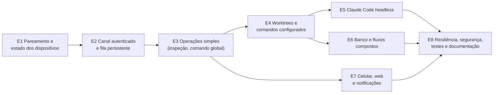

# Fase 2 — Orquestração remota: roteiro de implementação

> **Estado: em implementação.** As tarefas feitas estão marcadas com ✔ na lista
> do fim, com o commit de cada uma. A arquitetura está em
> [`../architecture/remote-orchestration.md`](../architecture/remote-orchestration.md),
> as ameaças e os requisitos RS-xx em
> [`../architecture/remote-security-threat-model.md`](../architecture/remote-security-threat-model.md)
> e as decisões nos ADR-084 a ADR-090 de [`../ARCHITECTURE.md`](../ARCHITECTURE.md).

## Princípios do roteiro

- **Cada entrega vale sozinha** e vai para a master atrás de "Aceitar controle
  remoto", que vem desligado. Quem não liga nada não vê diferença.
- **Offline-first intacto**: sem servidor, o desktop é exatamente o de hoje.
- **Refatorar antes de expor**: regra que só existe na tela desce para a
  Application num PR próprio (`refactor:`), com os testes da tela verdes, antes
  de qualquer uso remoto.
- **A primeira versão útil** (fim da entrega 4) controla **dois computadores
  reais**, Windows e Linux, **com o desktop fechado na máquina executora**.
- Commits e PRs seguem `docs/release-process.md` (Conventional Commits; o
  Release Please sobe a versão).

## Visão das entregas

| Entrega | Resultado visível | Depende de |
|---|---|---|
| E1 | lista "Máquinas" com online/offline, capacidades e pareamento com código | — |
| E2 | o agente sobe sem o desktop e responde a `environment.inspect` | E1 |
| E3 | rodar um comando liberado em outra máquina e ver a saída ao vivo; aprovar uma confirmação | E2 |
| E4 | **v1**: preparar o worktree de uma tarefa e rodar os comandos dele de longe | E3 |
| E5 | mandar um prompt ao Claude Code de longe, acompanhar e aprovar ferramentas | E4 |
| E6 | cópia de banco do ambiente de longe; "preparar tudo" numa operação só | E4 |
| E7 | tudo isso pelo celular | E3 (telas), E5/E6 (recursos) |
| E8 | testes de caos, revisão de segurança, guia do usuário | todas |

---

## E1 — Pareamento, registro e estado dos dispositivos

**Escopo**

- Escopo OAuth `remote` no OpenIddict e nos dois clientes; reconsentimento uma
  vez (ADR-087). O lado do servidor já está feito (T-02); o cliente só passa a
  pedir o escopo ao ligar o remoto (T-06), porque um servidor antigo recusa o
  login inteiro com `invalid_scope`.
- Chave ES256 por instalação, privada no `ISecretStore` (`"device-key"`).
- Servidor: `DeviceKeys`, `DeviceCapabilities` (papéis, protocolo, ferramentas,
  `LastHeartbeatAt`), `RemotePairings`; persistir o que hoje o
  `DeviceHello.Capabilities` descarta.
- Endpoints `PUT /api/v1/remote/devices/current`, `GET /api/v1/remote/devices`,
  `POST /api/v1/remote/pairings`, `GET|POST /api/v1/remote/pairings/{id}[/approve]`.
- Rate limiter `remote` separado de `sync` (ADR-069).
- Desktop: janela "Máquinas" (lista, online/offline, parear, revogar) e a
  confirmação do código do lado executor (por enquanto no próprio desktop).
- Projeto `MyTaskApp.Remote.Contracts` com os contratos de dispositivo e
  pareamento, e uma regra no `LayerDependencyTests`.

**Arquivos prováveis**

- `src/MyTaskApp.Remote.Contracts/*` (novo)
- `src/MyTaskApp.Server.Api/ServerSetup.cs` (escopo, limiter),
  `RemoteApiEndpoints.cs` (novo), `ConnectEndpoints.cs` (escopo no consentimento)
- `src/MyTaskApp.Server.Application/RemoteDevices.cs` (novo)
- `src/MyTaskApp.Server.Infrastructure/Persistence/ServerRows.cs`,
  `ServerDbContext.cs`, migration nova
- `src/MyTaskApp.Infrastructure/Remote/DeviceKeyStore.cs` (novo),
  `Sync/Http/SyncAuthenticationService.cs` (escopo)
- `src/MyTaskApp.Infrastructure/Persistence`: `TrustedControllers` e
  `RemoteExecutionSettings` + migration local
- `src/MyTaskApp.Desktop/ViewModels/MachinesViewModel.cs`, `Views/MachinesWindow.axaml` (novos)

**Testes**

- `Server.IntegrationTests`: escopo exigido; dispositivo revogado não registra
  chave; pareamento expira; código igual nos dois lados; outra conta não vê.
- `Infrastructure.Tests`: a chave sobrevive a reabrir; a privada nunca vai
  para o banco; a impressão digital é estável.
- `Sync.Contracts.Tests`/`Remote.Contracts.Tests`: JSON de ida e volta;
  nenhum contrato tem campo de senha, caminho ou host (reflexão).
- `UpgradePreservationTests`: as tabelas locais novas não entram no
  `SyncRegistry` (o teste de classificação de colunas do ADR-061 acusa).

**Riscos**: o reconsentimento pode confundir quem já usa o sync (mitigação:
pedir só ao ligar o remoto). O código curto precisa de entropia suficiente
(6 dígitos + nonce + validade curta).

**Critérios de aceitação**

- [ ] Dois computadores na mesma conta se veem em "Máquinas" com
      plataforma, versão e "online há X s".
- [ ] Parear exige o código confirmado na máquina executora; com o código
      errado, nada é gravado.
- [ ] Revogar some com a máquina da lista dos outros em até 30 s.
- [ ] Sem ligar o remoto, nenhuma tabela nova é escrita e o sync é o de hoje.

---

## E2 — Canal remoto autenticado e fila persistente

**Escopo**

- **Agente**: projeto `MyTaskApp.Agent` (console, net10.0), composto como o
  `McpTestHost` (`AddApplication` + `AddInfrastructure`), com mutex próprio
  `MyTaskApp.Agent` e `ICurrentUser` e `IAlertPresenter` próprios (sem UI).
- **SQLite para dois processos** (ADR-085): ~~WAL e migrate sob trava~~ feitos
  na T-07 (o WAL já existia pelo EF, a trava de migration é do próprio EF);
  ~~a tabela `ProcessLeases`, o ciclo do sync só no dono do lease e o refresh
  do token sob trava entre processos~~ feitos na T-08.
- ~~Mover `ScopedUseCaseRunner`~~ feito na T-09: está em
  `Application/Abstractions`, e o `AddApplication` o registra para todo host.
- **IPC local**: named pipe `CurrentUserOnly` (Unix socket no Linux): "dados
  mudaram", "sincronizar agora", pareamento local.
- **Servidor**: `RemoteOperations`, `RemoteOperationEvents` + migration; REST de
  operação (criar, ler, eventos, aceitar, recusar, concluir, cancelar); hub
  `/hubs/remote`; varredura de expiração (`BackgroundService`, como o
  `ProcessedOperationsPruner`).
- **Diário do agente**: `RemoteOperationJournal`, `RemoteOperationJournalEvents`.
- **Primeira operação**: `environment.inspect` (Git, Claude, gh, ferramentas
  PostgreSQL, catálogo). Não muda nada na máquina.
- **Instalação**: tarefa agendada no logon (Inno Setup) e unit
  `systemd --user` (`install.sh`); o instalador fecha e reabre o agente.

**Arquivos prováveis**

- `src/MyTaskApp.Agent/*` (novo): `Program.cs`, `AgentServices.cs`,
  `RemoteChannel.cs` (hub + REST), `OperationDispatcher.cs`
- `src/MyTaskApp.Application/Remote/*` (novo): `IRemoteOperationHandler<T>`,
  `RemoteOperationJournal` (porta), `InspectEnvironmentHandler`
- `src/MyTaskApp.Infrastructure/Persistence/DatabaseOptions.cs`,
  `DatabaseInitializer.cs`, migration local
- `src/MyTaskApp.Infrastructure/Remote/*` (novo): cliente HTTP/SignalR,
  verificador de JWS, `ProcessLeaseStore`, `LocalPipeServer`
- `src/MyTaskApp.Desktop/Composition/AppServices.cs`, `App.axaml.cs` (lease,
  pipe)
- `src/MyTaskApp.Server.Api/RemoteOperationEndpoints.cs`, `RemoteHub.cs` (novos)
- `src/MyTaskApp.Server.Application/RemoteOperations.cs` (novo)
- `installer/windows/MyTaskApp.iss`, `installer/linux/payload/install.sh`
- `Directory.Packages.props`: `Microsoft.AspNetCore.SignalR.Client`

**Testes**

- `Infrastructure.Tests`: **dois processos** (ou duas conexões sem
  compartilhamento) escrevendo ao mesmo tempo, sem `SQLITE_BUSY` visível; o
  lease troca de dono quando o processo morre; migrate concorrente roda uma vez.
- `Application.Tests`: dispatcher recusa assinatura inválida, alvo errado,
  `NotAfter` vencido, id repetido, tipo desconhecido.
- `Server.IntegrationTests`: criar é idempotente (mesmo id/hash → mesma
  operação; outro hash → 409); `Dispatched` sem aceite volta a `Queued`;
  `Expired` no `NotAfter`; eventos com `Seq` repetido ignorados; ack devolve o
  contíguo; transição inválida recusada; revogar derruba o hub.
- Ponta a ponta (como o `TwoDeviceSyncTests`): um desktop controlador e um
  agente contra o servidor real; o agente responde `environment.inspect` com o
  desktop **fechado**.
- `Packaging.Tests`: o instalador registra e remove a tarefa agendada / unit.

**Riscos**

- Backup que copia só o `.db` perde o que ainda está no `-wal`. Não é risco
  novo (o banco sempre esteve em WAL, ver T-07), mas dois processos abertos o
  tornam mais provável. Mitigação: a nota em "Onde ficam os dados" do README.
- O desktop deixa de ser dono do sync quando o agente está vivo: a bolinha
  (ADR-063) passa a ler o estado do banco e pedir "agora" pelo pipe.
- Proxy sem WebSocket: o fallback REST (30 s) precisa ser testado.

**Critérios de aceitação**

- [ ] Com o desktop **fechado** no computador B (Windows) e no C (Linux), o
      desktop A vê os dois online e recebe o `environment.inspect` de cada um
      em menos de 5 s.
- [ ] Desligar o Wi-Fi de B por 2 min e religar: a operação pedida nesse
      intervalo roda quando ele volta (se dentro do `NotAfter`) ou expira, e
      nenhum evento se perde.
- [ ] Abrir e fechar o desktop B com o agente rodando não duplica lembretes
      nem ciclos de sync.
- [ ] Nenhuma porta de entrada nova em B ou C (`netstat`: só loopback e
      conexões de saída).

---

## E3 — Execução remota de operações simples

**Escopo**

- `command.run` para **comandos globais e de diretório** com `RemoteAllowed`
  (coluna local, que cai quando o texto muda).
- ~~`RequiresConfirmation` cobrado no caso de uso~~ feito na T-18
  (`RunQuickCommand.Confirmed`). Falta o agente marcar o pedido só depois de
  uma aprovação remota.
- Aprovação: `RemoteApprovals` no servidor; `ApprovalRequest`/`ApprovalResponse`
  assinada; validade e negação por padrão.
- Saída ao vivo: `ICommandExecutor` → eventos `Output` mascarados, em lote.
- Cancelamento: `CancelRequestedAt` → `CancellationToken` → morte da árvore.
- Job Object (Windows) / grupo de processos (Linux) por operação.
- Recuperação após reinício do agente (seção 4.5 da arquitetura).
- Origem `"Remoto: <dispositivo>"` e auditoria de comando no `ITaskAuditLog`.

**Arquivos prováveis**

- `src/MyTaskApp.Domain/Commands/DevelopmentCommand.cs` (só a regra de "o
  texto mudou, cai a liberação"), mapeamento local no EF
- `src/MyTaskApp.Application/Remote/RunCommandRemotely.cs` (marca `Confirmed`
  só depois da aprovação)
- `src/MyTaskApp.Infrastructure/Processes/*` (Job Object / grupo)
- `src/MyTaskApp.Server.*` (aprovações)
- Desktop A: tela "Operação" (saída ao vivo, cancelar, aprovar)

**Testes**

- `QuickCommandHandlersTests`: sem confirmação, o caso de uso recusa (antes só a
  tela recusava); `QuickCommandsViewModelTests` continuam verdes.
- `CommandReviewSourcesTests`: comando alterado em outro computador é recusado
  também quando pedido de longe.
- Comando sem `RemoteAllowed` → `Rejected`; parâmetro com `;` ou `&` → recusado.
- Cancelar mata a árvore (neto incluso, como o `ProcessRunnerGrandchildTests`).
- Agente morto no meio: o filho morre junto e a operação fica `Interrupted`.
- Aprovação: resposta com `RequestHash` de outra → recusada; usada duas vezes →
  recusada; expirada → nega.

**Riscos**: tornar `RequiresConfirmation` obrigatório no caso de uso muda a
tela (refatoração com teste). Saída muito grande: teto por operação.

**Critérios de aceitação**

- [ ] De A, rodar em B um comando global liberado e ver a saída linha a linha
      com menos de 1 s de atraso.
- [ ] Um comando com "pedir confirmação" para em `WaitingApproval` até
      alguém aprovar em A.
- [ ] Cancelar em A encerra o processo em B em até 5 s.
- [ ] Um comando não liberado nunca roda, nem com a operação forjada direto no
      banco do servidor (teste com o servidor "comprometido").

---

## E4 — Preparação de worktrees e comandos configurados (v1)

**Escopo**

- **Refatoração primeiro** (PR `refactor:` próprio): extrair a sequência de
  `TaskDevelopmentViewModel.StartAsync/CreateAsync` para
  `ProvisionEnvironmentHandler` na Application, com as decisões como dados
  (`WorktreeConflictPolicy`, confirmação de produção por porta). O ViewModel
  passa a chamá-lo.
- `worktree.provision` (preparar → worktree → comandos pós-worktree), com
  checkpoints e retomada (`AdoptExisting`).
- `worktree.remove` (aprovação obrigatória).
- `command.run` dentro do worktree (comandos rápidos, ADR-051).
- Tarefa criada no controlador: `RequiredEntities` faz o agente sincronizar e
  esperar a tarefa chegar (até 2 min).
- Clone no agente sem janela de login (`GCM_INTERACTIVE=Never`).
- Desktop A: "Preparar em…" na aba Desenvolvimento de uma tarefa.

**Arquivos prováveis**

- `src/MyTaskApp.Application/Development/ProvisionEnvironment.cs` (novo)
- `src/MyTaskApp.Desktop/ViewModels/TaskDevelopmentViewModel.cs`,
  `DevelopmentDatabaseViewModel.cs`
- `src/MyTaskApp.Application/Remote/ProvisionEnvironmentRemotely.cs`,
  `RemoveWorktreeRemotely.cs`
- `src/MyTaskApp.Infrastructure/Git/GitClient.cs` (clone sem prompt, por opção)

**Testes**

- `TaskDevelopmentViewModelTests` e `TaskDevelopmentsViewModelTests` **sem
  mudança de expectativa** (prova de que a refatoração não mudou o produto).
- `ProvisionEnvironmentHandlerTests`: cada política de conflito; falha em
  cada etapa; retomada adota o worktree existente; tarefa ausente espera e
  depois falha com mensagem.
- `GitWorktreeIntegrationTests` com o fluxo remoto.
- Ponta a ponta: A pede, B (desktop fechado) cria o worktree; o ambiente
  aparece em A como `NotCreatedHere` pelo sync, como já acontece hoje.

**Riscos**: o `TaskDevelopmentViewModel` tem 2009 linhas; a extração é a
parte mais delicada do roteiro (mitigação: PR só de refatoração, sem mudança de
comportamento, como em `docs/refactoring/PROGRESS.md`).

**Critérios de aceitação (v1)**

- [ ] No celular ou em A: criar uma tarefa, escolher B, escolher o
      repositório e a branch de origem, e B cria o worktree e roda os comandos
      pós-worktree, **com o desktop de B fechado**, em Windows e em Linux.
- [ ] Derrubar o agente de B durante o `git worktree add` e religar: a
      operação termina ou fica `Interrupted` com a etapa dita; "Repetir" adota
      o worktree já criado.
- [ ] Remover o worktree de longe exige aprovação e recusa se houver sessão do
      Claude ativa (regra existente).

---

## E5 — Execução e acompanhamento do Claude Code

**Escopo**

- **Conferir primeiro, com o modelo de verdade**, num teste opt-in
  `MYTASKAPP_TEST_CLAUDE=1` (como o ADR-081 fez):
  - o formato dos eventos do `stream-json`;
  - o contrato da ferramenta de `--permission-prompt-tool`.

  Os flags já foram conferidos no 2.1.309 sem chamar o modelo (arquitetura,
  seção 7). `--permission-prompt-tool` e `--max-turns` são aceitos mas não
  aparecem na ajuda: o teste os cobre, e o `DetectAsync` exige a versão
  mínima conferida.
- Base da linha de comando: `-p --restricted`, `--tools` do perfil,
  `--strict-mcp-config` e `--settings` gerado pelo agente (seção 2.5 da
  arquitetura); `--max-turns` e `--max-budget-usd` com teto local.
- `IHeadlessAgentProvider` no `ClaudeCodeCliProvider`; prompt pelo stdin (sem a
  limitação de `"` e `%` do `claude.cmd`).
- `AgentSession.Mode` (Interativo/Headless), status `Stopped`,
  `RemoteOperationId`; migration local.
- Perfis locais (leitura; editar no worktree; editar + comandos de teste),
  com `--allowedTools`, `--disallowedTools` e `permissions.deny`.
- MCP de aprovação no agente (o padrão do `McpSecurityMiddleware`, segredo por
  sessão) → `ApprovalRequest` → resposta assinada.
- `agent.start`, `agent.prompt` (`--resume`), `agent.stop`.
- Eventos `AgentMessage`, `ToolUse`, `Result` (custo, turnos) a partir do
  `stream-json`; `AgentActivity` derivada (esperando aprovação = esperando você).
- Desktop A: painel da sessão remota (conversa, ferramentas, aprovar/negar).

**Arquivos prováveis**

- `src/MyTaskApp.Application/Agents/IHeadlessAgentProvider.cs`,
  `AgentSessionHandlers.cs` (modo headless)
- `src/MyTaskApp.Domain/Agents/AgentSession.cs`
- `src/MyTaskApp.Infrastructure/Agents/ClaudeCode/ClaudeCodeCliProvider.cs`,
  `ClaudeStreamJsonReader.cs` (novo)
- `src/MyTaskApp.Agent/Approvals/ApprovalMcpServer.cs` (novo)

**Testes**

- `ClaudeCodeCliProviderTests`: os `DefaultArguments` do card nunca aparecem no
  headless; `bypassPermissions` recusado; `--restricted` sempre presente;
  ambiente sem `PG*`, `GH_TOKEN` e `MYTASKAPP_*` alheios; o `--settings`
  gerado é JSON válido (o `-p` ignora em silêncio um arquivo inválido).
- `ClaudeStreamJsonReaderTests` com saídas gravadas da versão conferida.
- Aprovação: negar devolve `deny` ao Claude; expirar nega; o MCP recusa sem o
  segredo, com `Origin` e fora do loopback.
- `AgentSessionTests`: `Stopped` só a pedido; reconciliação com o processo morto.
- Opt-in com o Claude real: uma pergunta de leitura termina sem aprovação; um
  `Bash` fora do perfil para em `WaitingApproval`.

**Riscos**: mudanças de flags entre versões do Claude Code (mitigação: versão
mínima conferida no `DetectAsync`; recusa com mensagem clara). Prompt injection
(risco residual R-03).

**Critérios de aceitação**

- [ ] Do celular ou de A, mandar um prompt para a tarefa em B; ver a resposta e
      as ferramentas usadas ao vivo.
- [ ] Uma ferramenta fora do perfil aparece para aprovação; negar faz o Claude
      seguir sem ela.
- [ ] Um segundo prompt continua a mesma conversa (`--resume`).
- [ ] "Parar" encerra o processo e a sessão fica `Stopped`.
- [ ] Em nenhum caminho o processo recebe `--dangerously-skip-permissions`.

---

## E6 — Operações de banco e fluxos compostos

**Escopo**

- `database.copy` por ids do catálogo (conexões com `RemoteAllowed` local).
- Confirmação de produção e nome digitado por `ApprovalKind.ProductionDatabase`.
- `DatabaseOperationGate` e `RecoverInterruptedDatabaseOperationsHandler` entre
  processos (dono = PID + início na auditoria).
- `worktree.provision` com a cópia de banco do ambiente (ADR-060) e,
  opcionalmente, `agent.start` no fim: "preparar tudo" numa operação.

**Arquivos prováveis**

- `src/MyTaskApp.Application/DatabaseOperations/CopyHandlers.cs` (confirmação por
  porta), `ProfileHandlers.cs` (gate entre processos)
- `src/MyTaskApp.Domain/DatabaseOperations/DatabaseOperationAudit.cs` (dono)
- `src/MyTaskApp.Application/Remote/CopyDatabaseRemotely.cs`

**Testes**

- `RunDatabaseCopyHandlerTests` e `DatabaseSecurityPolicyTests` **inalterados**.
- Produção pedida de longe sem aprovação → `Blocked` na auditoria;
  `CriticalProduction` com nome errado → recusado.
- Conexão sem `RemoteAllowed` → `Rejected`; o catálogo não mostra host nem usuário.
- Duas cópias em processos diferentes → a segunda espera ou recusa.
- O desktop abrindo a janela de Bancos não marca como interrompida a cópia viva
  do agente.
- `PostgresIntegrationTests` (opt-in) com a cópia disparada pelo agente.

**Riscos**: confirmação de produção num celular é mais fácil de dar sem ler
(mitigação: digitar o nome; resumo com origem, destino, perfil e tabelas).

**Critérios de aceitação**

- [ ] De longe, a cópia anonimizada de uma origem de produção roda só depois
      da aprovação com o nome digitado, e a auditoria mostra o dispositivo.
- [ ] Nenhuma operação remota cria, edita ou lê uma conexão ou senha.
- [ ] "Preparar tudo" (worktree + banco + comandos + Claude) termina com
      checkpoints visíveis, e a falha numa etapa diz qual.

---

## E7 — Interface mobile/web e notificações

**Escopo**

- `Mobile.Core`: cliente remoto (o mesmo do desktop), telas Máquinas,
  Operações (lista e detalhe ao vivo), Aprovações, Sessão do Claude; assinatura
  depois de destravar (biometria/PIN).
- Notificações com o app aberto ou em segundo plano recente (hub e polling).
- Sem push com o app fechado na v1. A decisão entre Firebase Cloud Messaging e
  um servidor de push do próprio usuário fica para um ADR próprio.
- Web: fora da v1. Um cliente web precisaria guardar a chave de assinatura no
  navegador (WebCrypto, não exportável) e passar pelo mesmo pareamento.

**Arquivos prováveis**

- `src/MyTaskApp.Mobile.Core/ViewModels/Machines*`, `RemoteOperation*`,
  `Approval*` (novos); `Composition/MobileServices.cs`
- `src/MyTaskApp.Mobile/Views/*` e `AppShell.xaml`

**Testes**

- `Mobile.Core.Tests`: as telas com o cliente falso; assinatura só depois de
  destravar; aprovação expirada some.
- `MobileLayerTests`: o núcleo continua sem MAUI.
- `PhoneSyncTests` + ponta a ponta: o celular pede, o agente executa.

**Riscos**: o Android mata conexões em segundo plano; aprovações podem expirar
sem ninguém ver (é seguro, porque nega, mas frustra). Mitigação futura: push.

**Critérios de aceitação**

- [ ] Do celular, o fluxo inteiro da v1 (tarefa → máquina → worktree →
      comandos → Claude) sem tocar em nenhum computador.
- [ ] Uma aprovação pendente aparece no celular em até 2 s com o app aberto.

---

## E8 — Resiliência, segurança, testes e documentação

**Escopo**

- Testes de caos ponta a ponta: matar o agente, reiniciar o servidor, cortar a
  rede, relógio adiantado, eventos duplicados e fora de ordem.
- Revisão de segurança contra o modelo de ameaças (todos os RS-xx com teste ou
  justificativa); `docs/security/` atualizado.
- Retenção: eventos 30 dias no servidor; diário 7 dias no agente.
- Guia do usuário `docs/remote.md` (ligar, parear, revogar, perfis, limites) e a
  seção no README; `sync-server.md` com o hub atrás do proxy (WebSocket).
- Corrigir as divergências doc × código listadas na seção 1.12 da arquitetura.

**Critérios de aceitação**

- [ ] Todo RS-xx tem um teste automatizado ou uma linha de "risco aceito" no
      modelo de ameaças.
- [ ] Os cenários de 4.6 da arquitetura têm teste ponta a ponta.
- [ ] Cobertura das classes novas de Application e Server.Application ≥ a média
      do projeto.

---

## Lista priorizada de tarefas

Cada tarefa cabe num PR. "Pronto" é o critério objetivo de conclusão.

| # | Tarefa | Entrega | Depende de | Pronto quando |
|---|---|---|---|---|
| T-01 ✔ | Projeto `MyTaskApp.Remote.Contracts` + regra no `LayerDependencyTests` (commit `c2c94d3`; inclui as transições em `RemoteOperationLifecycle` e a conferência em `RemoteOperationRules`) | E1 | — | build verde; teste de camadas acusa referência ao app |
| T-02 ✔ | Escopo `remote` no OpenIddict, nos clientes e no consentimento; política `RemotePolicy` (sync + remote), commit `9608aab`. Os clientes passam a pedi-lo na T-06 | E1 | — | `RemoteScopeTests`: token sem `remote`, ou só com `remote`, recebe 403 da política; com os dois, passa, também depois do refresh e no celular |
| T-03 ✔ | Chave ES256 por instalação no `ISecretStore` (`DeviceKeyStore`, commit `c6307f9`); impressão digital em `DevicePublicKey.FingerprintOf` | E1 | T-01 | `DeviceKeyStoreTests`: reabrir mantém a impressão digital, só o segredo `device-key` é gravado, assinatura no formato do JWS, uma chave só com chamadas simultâneas |
| T-04 ✔ | `DeviceKeys`, `DeviceCapabilities` (migration `RemoteDevices`; commit `f8ad640`), `PUT /api/v1/remote/devices/current` e `GET /api/v1/remote/devices`, rate limiter `remote` | E1 | T-02, T-03 | `RemoteDeviceTests` e `RemoteDeviceUseCasesTests`: a lista mostra papéis, ferramentas e sinal de vida; chave nova no mesmo `DeviceId` revoga a anterior (os pareamentos dela caem com a T-05); desktop e agente registrando juntos ficam com uma chave |
| T-05 ✔ | Pareamento com código derivado e `TrustedControllers` local (servidor: commit `6184fe3`; app: commit `6eca19c`, `ConfirmPairingHandler`, o código é digitado no executor; ponta a ponta com o desktop de verdade: `be34351`) | E1 | T-04 | código errado não grava; certo grava dos dois lados; pareamento de uma chave revogada (T-04) deixa de valer |
| T-06 ✔ | Janela "Máquinas" no desktop; ligar o remoto pede o login de novo com `remote`, registra o `DeviceKeyStore` na composição e chama `PUT /remote/devices/current` (núcleo: commit `dae7925`; janela: `29bd4fa`; sinal de vida a cada minuto pelo `RemotePresenceScheduler`, até o agente assumir na T-13) | E1 | T-04, T-05 | parear, revogar e ver online/offline sem reiniciar; quem não liga o remoto continua pedindo só `sync` |
| T-07 ✔ | WAL garantido na abertura; escritor ocupado espera; migration concorrente roda uma vez (commit `4a48578`). Achado: o banco já estava em WAL pelo EF, e o ADR-059 dizia o contrário | E2 | — | `DatabaseInitializerTests` (um arquivo em outro modo volta a WAL, dois escritores, duas migrations ao mesmo tempo); `UpgradePreservationTests` verdes |
| T-08 ✔ | `ProcessLeases` (dono = PID + início) e o ciclo do sync só no dono do lease, que vai para o outro processo quando vence ou quando o dono morre; refresh sob o lease `sync-token`, relendo o cofre. O gate fica no `SyncEngine`, depois de conferir a conta: sem sync, nada é gravado. O celular usa `SingleProcessLeases` | E2 | T-07 | `SqliteProcessLeasesTests`, `ProcessLeaseHoldTests` e `TwoProcessSyncTests`: dois processos, um ciclo de sync por vez; nenhum refresh antigo apresentado (o teste falha sem o lease) |
| T-09 ✔ | `ScopedUseCaseRunner` único, em `Application/Abstractions` (commit `450936c`) | E2 | — | Desktop, Mobile.Core e os harnesses de teste usam o mesmo; testes de composição verdes |
| T-10 ✔ | `MyTaskApp.Agent` (host, mutex `MyTaskApp.Agent`, composição `AddAgent` com as portas de tela sem tela; sobe a sincronização e o sinal de vida; para no SIGTERM/SIGINT) | E2 | T-07, T-08, T-09 | `AgentTests`: a composição inteira valida no build (`ValidateOnBuild`), sobe e para sem o desktop, e o executável de verdade roda como processo próprio, com um segundo saindo na hora |
| T-11 | Pipe local (dados mudaram, sincronizar agora) | E2 | T-10 | desktop atualiza a lista quando o agente grava |
| T-12 | `RemoteOperations`/`Events` no servidor + REST idempotente | E2 | T-01, T-04 | testes de idempotência, `Seq` e transições |
| T-13 | Hub `/hubs/remote` + fallback de polling | E2 | T-12 | sem WebSocket, a operação chega em ≤ 30 s |
| T-14 | Diário do agente, verificação de JWS e dispatcher | E2 | T-05, T-10, T-12 | recusas de 4.4 com motivo; reinício reenvia eventos sem ack |
| T-15 | `environment.inspect` ponta a ponta | E2 | T-13, T-14 | critério de aceitação da E2 |
| T-16 | Instalador: tarefa no logon / `systemd --user` | E2 | T-10 | `Packaging.Tests`; instalar e desinstalar limpam tudo |
| T-17 | `RemoteAllowed` local em comandos (cai quando o texto muda) | E3 | T-07 | sync não altera a coluna; editar o texto a desliga |
| T-18 ✔ | Confirmação cobrada no caso de uso, por `RunQuickCommand.Confirmed` (commit `06da30f`) | E3 | — | `QuickCommandHandlersTests` novo; testes da tela verdes |
| T-19 | Aprovações (servidor, contratos, agente) | E3 | T-14 | reuso, hash errado e expiração recusados |
| T-20 | `command.run` com saída ao vivo, cancelamento e Job Object/grupo | E3 | T-17, T-18, T-19 | critérios da E3 |
| T-21 | Auditoria de comando/ambiente/agente com origem remota | E3 | T-20 | cada operação gera uma linha no `ITaskAuditLog` |
| T-22 | Extrair `ProvisionEnvironmentHandler` do ViewModel | E4 | — | `TaskDevelopmentViewModelTests` sem mudança de expectativa |
| T-23 | `worktree.provision` com checkpoints e `RequiredEntities` | E4 | T-20, T-22 | critérios da E4 |
| T-24 | `worktree.remove` com aprovação | E4 | T-19, T-23 | recusa com sessão ativa; exige aprovação |
| T-25 | "Preparar em…" no desktop | E4 | T-23 | fluxo da v1 pelo desktop A |
| T-26 | Teste opt-in com o Claude real: eventos do `stream-json` e contrato da `--permission-prompt-tool` (os flags já conferidos no 2.1.309) | E5 | — | teste opt-in verde; saídas gravadas para os testes de unidade; versão mínima no ADR-089 |
| T-27 | `IHeadlessAgentProvider` + leitor de `stream-json` | E5 | T-26 | testes com saídas gravadas |
| T-28 | `AgentSession.Mode`, `Stopped`, `RemoteOperationId` | E5 | — | migration + `AgentSessionTests` |
| T-29 | MCP de aprovação + perfis locais | E5 | T-19, T-27 | `Bash` fora do perfil para em aprovação; sem resposta, nega |
| T-30 | `agent.start` / `agent.prompt` / `agent.stop` + painel no desktop | E5 | T-27, T-28, T-29 | critérios da E5 |
| T-31 | Gate e recuperação de cópia entre processos | E6 | T-07 | a janela de Bancos não interrompe a cópia do agente |
| T-32 | `database.copy` com aprovação de produção | E6 | T-19, T-31 | critérios da E6 |
| T-33 | "Preparar tudo" (worktree + banco + comandos + Claude) | E6 | T-23, T-30, T-32 | checkpoints visíveis; falha diz a etapa |
| T-34 | Cliente remoto e telas no `Mobile.Core` | E7 | T-15 (e T-20, T-30 para os recursos) | critérios da E7 |
| T-35 | Testes de caos ponta a ponta | E8 | T-15, T-23 | os cenários de 4.6 automatizados |
| T-36 | Revisão de segurança RS-xx e `docs/remote.md` | E8 | todas | cada RS com teste ou risco aceito |

**Caminho crítico até a v1** (dois computadores reais, desktop fechado no
executor): T-01 → T-02 → T-03 → T-04 → T-05 → T-07 → T-08 → T-09 → T-10 → T-12 →
T-13 → T-14 → T-15 → T-17 → T-18 → T-19 → T-20 → T-22 → T-23. As tarefas T-07,
T-09, T-18 e T-22 não dependem do servidor e podem começar em paralelo.
